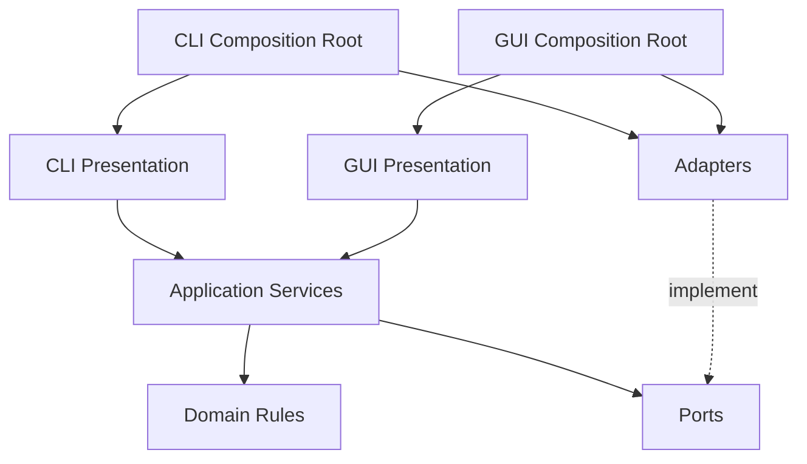

# Ataraxia アーキテクチャ再設計

## 目的

本書は、現行のスクリプト構成を、高凝集・疎結合・依存性逆転を満たす構成へ段階的に移行するための設計記録である。これは単なるフォルダー整理ではない。依存方向、責務、外部I/Oの境界、起動時の組み立て方、テスト可能性を一緒に再設計する。

## 現状評価

現行の利用者向け挙動と構造化設定は、再設計中も基準として保持する。2026-11-27 時点の作業ツリーでは、主な実行ファイルの規模と課題は次のとおり。

| 現行ファイル | 概算規模 | 混在している責務・問題 | 目標 |
|---|---:|---|---|
| `scripts/Start-AtaraxiaGui.ps1` | 72 KB | WPF起動、イベント結線、残存GUI状態、KoboldCpp制御、画面描画が同居。Window / Splash XAMLとProject/Session Use Caseは分離済み | WPFイベントと表示処理をさらにPresentation moduleへ移し、状態を明示Modelへまとめる |
| `scripts/AgentCore.ps1` | 10 KB | Task factory、互換Core workflow導入、設計workflow取込の調整が残る。Phase input projectionもRoleExecutionへ分離済み | Core組立と設計workflowの凝集性を保ち、互換ファサードを削除可能にする |
| `scripts/AgentHarness.ps1` | 32 KB | Workspace policy、inventory利用、diff apply、journal、rollbackが同居。Reader/FileStore/Process Portは接続済み | Safety validation、Workspace use case、Journalを責務ごとに分離 |
| `scripts/Invoke-Agent.ps1` | 18 KB | CLI実行ループとrole orchestrationがまだ大きく、設定とAdapter wiringも同居 | CompositionとCLI presentationを分け、Application runnerへ委譲 |
| `scripts/GuiDialogs.ps1` | 17 KB | ダイアログ契約、状態、WPF描画、ファイルシステム参照が同居 | Dialog contract factory／action検証／renderer結果正規化とWPF / filesystem Adapter を分ける |

外部I/Oの注入は個別の機能に存在するが、全域で統一されたPort契約やComposition rootには至っていない。スクリプトをドットソースすることで関数とスコープを共有しており、GUIは可変な `$script:` 状態にも依存している。`WorkspaceReaderPort.ps1` と `WorkspaceFileSystem.ps1` は契約・Adapterの試作であり、現行Harnessから呼ばれていない。これらを一度に置き換えると障害の範囲とレビュー負荷が大きくなるため、振る舞いをテストで固定した後に縦切りで分離する。

## 移行状況

| スライス | 状態 | 達成した境界 | 次の作業 |
|---|---|---|---|
| GUI Application / View | Application Use Case実装済み、View資産分離済み | Project/Session Use Case、Window/Splash XAMLを外出し。会話表示モデルからアセットI/Oとglobal icon mapを除去し、geometryを引数注入。Theme状態は純粋モデル、Windowsのsystem theme読取とWPFブラシ適用は別Adapterへ分離。KoboldCpp接続先の検証と起動計画もApplicationへ移動。モデルパラメータ入力検証、KoboldCpp接続状態、session selector同期状態をheadlessモデル化。`GuiPresentationPort.ps1`を導入し、3種の一覧、状態メッセージ、theme/model/session選択、静的操作、動的ドロワー／設定部品操作、メニュー操作と展開状態、遅延UI処理、process timer、splash delayをWPF adapter経由で描画・結線。翻訳済みラベル・ツールチップ・テーマ選択肢は`GuiLocalizedPresentation.ps1`で表示データへまとめ、WPF View AdapterはキーとWPFプロパティの対応だけを担う。タスク・編集・保留中プロジェクト・ドロワー展開状態は`GuiScreenState.ps1`へ、モデル設定欄のloading／dirty／initialized状態は`GuiModelParameterEditorState.ps1`へ分離。会話／設定画面とドロワー表示の遷移は`GuiNavigationState.ps1`で決定し、View Portへ真偽値で渡す。プロセスのidle/running/completed/stopped、出力カーソル、実行ロール、終了コードは`GuiProcessState.ps1`で管理。出力ポーリング、完了時の表示・一覧更新判断、ロールバック要否、実行とSTA再起動の引数生成は`GuiProcessApplication.ps1`へ移し、`PowerShellGuiProcessAdapter.ps1`がエージェント、KoboldCpp本体、取得用プロセス、STA再起動子プロセスの開始・状態確認・停止・終了・待機を担う。ファイル出力Adapterを注入し、プロセス判断をWPFなしに検証 | Composition rootのController分割とKoboldCpp設定・接続処理のユースケース化 |
| ProcessRunner Port | 実装済み | `AgentHarness.ps1` は許可検証後に結果契約を検査する。OS process生成はAdapterに分離し、CLI compositionが注入 | command allowlist policyとprocess adapterの残存結合を評価 |
| Workspace Reader / FileStore Port | Workspace I/O境界を実装済み | Snapshot/mediaは共通inventoryを一度作って共有。Journal、state保存、diff apply、rollbackはFileStore経由でCLI compositionが注入 | workspace path/reparse安全検査とsystem prompt読込を適切な担当へ移す |
| AgentCore分割 | 主要責務を分離済み | Workflow、Role/Prompt実行・phase input、State、実行設定・task validationを各モジュールへ移動 | Core workflow設計の取り込みとTask factory/migration関数を用途別に整理し、互換facadeを削除可能にする |
| GUI composition / view | 一部完了 | Window/Splash XAML資産とProject/Session application functionsを独立。Windowは約29 KBの別XML資産。子プロセス出力Adapter、純粋な出力解析、動的プロジェクト・セッションドロワーとモデル設定部品のWPF Adapterを分離。Dialog application serviceに契約生成・文言・結果変換依存を注入し、WPF renderer/path pickerと分離。設定画面遷移、Clipboard、focus、編集カーソル、会話スクロールをView Portへ移動。KoboldCppのmanaged restart順序と待機期限もcallback注入型application use caseへ移動 | 残るWPF固有の直接表示更新とGUI状態をView Adapterまたは画面状態モデルへ縦切りで移す |

`ProcessRunnerPort.ps1` / `PowerShellProcessRunner.ps1`、`WorkspaceReaderPort.ps1` / `WorkspaceFileSystem.ps1`、`WorkspaceFileStorePort.ps1` / `FileSystemWorkspaceStore.ps1` はCLI compositionから使われる。Readerは列挙・snapshot・mediaの読み取り境界、FileStoreはjournal/state/diff適用/rollbackの存在確認・読書き・置換境界を所有する。ApplicationとHarnessはStore契約だけに依存し、実filesystemはComposition rootが選択する。path/reparse防御の環境照会とsystem prompt読込はこのスライスの対象外である。

GUIのWindow/Splash XAMLは `scripts/presentation/*.xaml` に分離し、起動スクリプトは読み込み後のWPF control結線を行う。XML構造テストはWPFを起動しない。Project/Sessionユースケースは `GuiApplication.ps1` が所有する。Project/session overviewをStore portsから組み立て、UIは返されたprojectionを描画する。session選択は所属とtask pathを検証し、必要時だけproject activation portを呼ぶ。project準備は必要時のcreateとactivationを調整し、session create・project rename・session title updateも明示Adapter経由で実行する。GUI composition rootはProjectStore / SessionStoreの関数をAdapterとして束ねる。`GuiPresentationPort.ps1` は画面キー、boolean表示状態、Clipboard・focus・scroll・caret操作、項目一覧、操作契約、遅延実行優先度、周期timer、responsive delayを受け取るframework-neutral契約を持ち、`adapters/WpfGuiViewAdapter.ps1` がコントロール更新、booleanからWPF Visibilityへの変換、イベント結線、Dispatcher優先度、タイマー生成・停止、responsive waitへ変換する。この境界は会話・session・model一覧、状態メッセージ、theme/model/session選択、名前付きwindow/toolbar操作、ユーザー入力、会話スクロールイベントとscroll命令、Enter送信／Shift+Enter改行の解釈、入力レイアウト計算と会話更新の遅延処理、KoboldCpp status resolution、process polling、splash delayに接続し、fake adapterでWPFなしに表示・操作・スケジュール・時間制御を検証する。翻訳済みの固定表示データは`GuiLocalizedPresentation.ps1`の画面非依存モデルへ解決し、WPF Adapterがコントロール名と`Text` / `ToolTip`等のプロパティ対応を適用する。コンテキストメニューAdapterにも完成済みのローカライズ値を渡し、WPF側で翻訳キーを解決しない。動的設定部品・ドロワー行・コンテキストメニュー、キーと修飾キーの判定は `submit` 操作契約へ閉じ込め済み。ドロワー行やモデル設定部品などの動的対象はキーをPortへ登録してイベントを結線する。メニュー操作と展開状態はPort経由。セッション操作と会話コピーのContextMenu構築・ローカライズは `adapters/WpfContextMenuAdapter.ps1` が担う。滑らかな展開・折り畳みアニメーションのWPFイベント結線は `adapters/WpfSmoothExpanderAdapter.ps1` に分離済み。GUI起動スクリプトは個別イベントAPIを直接呼ばず、設定画面遷移をPort経由のboolean表示状態へ、Clipboard、focus、編集カーソル位置、会話スクロール操作もPortの注入可能な操作へ移動した。入力欄の高さ計算はpureな `GuiInputLayout.ps1` に置き、WPF Adapterが実測値を渡して適用する。残りは `$script:` 状態、その他表示更新とsession selector等の制御状態をPresentation/controllerへ分ける作業。会話表示変換は入力データとrole icon geometryのみを受け取り、WPF・ファイルシステム・global icon mapへ依存しない。SVG解析はXML文字列からgeometry文字列への変換とし、`adapters/WpfIconAssetAdapter.ps1` がアセット読込とWPF Geometry/Path変換を担う。テーマ設定と実効テーマの遷移は `GuiTheme.ps1` のheadless state modelが決定し、WPF側は設定保存・selector同期を行い、palette反映は `adapters/WpfThemeAdapter.ps1` が担う。session selectorのプログラム同期中かユーザー選択かの区別も `GuiApplication.ps1` の明示状態で表し、従来のGUI bool flagを除去した。これらのモデルはWPFなしで値入力による契約テストを実施する。

## 目標モジュール

すべて PowerShell と既存の標準機能で実装し、新しい外部ライブラリや常駐サーバーは追加しない。ディレクトリは責務を示すものであり、ファイルを細分化すること自体を目標にしない。

| 目標モジュール | 所有する振る舞い | Port / Adapter 境界 |
|---|---|---|
| `scripts/domain/Workflow.ps1` | ワークフロー構造・遷移・状態不変条件の検証 | 外部依存なし |
| `scripts/domain/RoleContracts.ps1` | Schema参照と入力／出力契約の検証 | 構造化データ値のみ |
| `scripts/domain/WorkspaceChanges.ps1` | 相対パス規則、差分操作、基準ハッシュの検証 | ファイルI/Oなし |
| `scripts/application/AgentRunner.ps1` | ロール順序・圧縮・遷移を調整する実行ユースケース | LLM、TokenCounter、StateStore、Loggerを注入 |
| `scripts/application/ProjectSessionService.ps1` | プロジェクトとセッションのユースケース、選択状態の投影 | ProjectStore、SessionStore、Clock、IdGeneratorを注入 |
| `scripts/application/WorkspaceService.ps1` | 作業対象読込、差分計画、適用、復元の調整 | WorkspaceStore、ChangeJournal、CommandRunnerを注入 |
| `scripts/application/GuiApplication.ps1` | GUIから呼ばれるユースケースと画面非依存の表示モデル | アプリケーションサービスを注入。WPF参照なし |
| `scripts/ports/*.ps1` | Adapterが満たす引数・戻り値・失敗の契約 | 共通データ形式のみ |
| `scripts/adapters/File*.ps1` | JSON、プロジェクト、セッション、ワークスペースのディスク操作 | .NET / PowerShell filesystem。Workspace journal/state/diff向けFileStore Adapterを実装 |
| `scripts/adapters/KoboldCpp*.ps1` | Token API、Chat Completion、KoboldCpp設定と起動 | HTTP、設定ファイル、プロセス |
| `scripts/adapters/Process*.ps1` | 許可済み外部コマンドのプロセス起動・終了 | OS process API |
| `scripts/presentation/AtaraxiaGui.ps1` | WPFウィンドウ、XAML、操作イベント、画面更新 | GUI Applicationの契約のみ |
| `scripts/presentation/AtaraxiaCli.ps1` | CLI引数・標準入出力とエラー表示 | Applicationの契約のみ |
| `scripts/Invoke-Agent.ps1`, `scripts/Start-AtaraxiaGui.ps1` | Composition root。設定ロード、Adapter生成、依存の束ね、起動 | 全層を参照してよい唯一の入口 |

利用者データJSONの読み込みは `StructuredData.ps1` が破損候補をファイル種別別に投影し、GUI Composition rootが承認コールバックと `New-AgentJsonFileSystemPort` で作成するファイルシステムポートを渡す。読込、属性確認、バックアップ作成、ステージ書込、置換、後始末はこのポートを通る。承認後の適用は完全バックアップ、原本ハッシュ再確認、一時ファイル検証、置換の順で行い、ステージ後・置換前にもハッシュを再確認する。実行ジャーナルとソース管理下のJSON資源は推測修復しない。読み込み・候補生成・承認拒否・バックアップ・競合拒否はGUIを起動しないテストで検証する。

プロジェクト、セッション、会話、共通プロンプトのJSON保存は `JsonFileStore.ps1` の `Write-AtaraxiaJsonStoreFile` に集約する。既定実装は同じディレクトリへ一意な一時ファイルを書き、JSONとして再読込できることを確認した後に置換する。プロジェクト・セッションstoreは同じ依存オブジェクトを使ってパス検査、ディレクトリ列挙・作成、項目属性取得、移動を行い、GUI Composition rootがOSファイルシステムadapterを組み立てる。各storeがreader/writerを差し替えられるため、アプリケーション層の判断と保存先の技術を分離できる。

ワークスペース走査の実OSアクセスは `WorkspaceFileSystem.ps1` に閉じ、`WorkspaceReaderPort.ps1` はその操作をreader契約へ接続する。reader portはファイル列挙・byte/hash読込に加え、root解決、存在種別、reparse point属性をpath portとして提供する。実行時の変更適用は `FileSystemWorkspaceStore.ps1` が同じpath portとmutation portを実装する。`AgentHarness.ps1` はワークスペースrootと変更先の安全検査をportへ委譲する。アプリケーション層ではbytes、hash、directory entry、path metadataの契約値を受け取り、PowerShell filesystem APIを直接呼ばない。ハーネス設定JSONも共通JSON storeから読む。

CLI composition rootの `Invoke-Agent.ps1` はconfig、task、session metadata、stateのJSON読込・保存をJSON storeへ、実行排他を `TaskExecutionLock.ps1` のacquire/release portへ委譲する。stateとworkspace変更のjournal適用はworkspace mutation storeを使う。CLI本体は具体的なPowerShell filesystem APIを呼ばず、各既定adapterがOS依存処理を所有する。

KoboldCppの共通設定とモデルsidecarも `JsonFileStore.ps1` 経由で読み書きする。GUIは承認付きreaderをstoreへ注入し、CLI/initializerは既定readerを使用する。設定の一時書込・JSON検証・置換も共通writerに一本化する。

`Initialize-KoboldCpp.ps1` はrelease asset選択とdigest検証付き取得を `KoboldCppInstaller.ps1` serviceへ委譲する。release取得、download、directory作成、hash、staging削除、配置はadapter依存で、serviceはHTTPS URLとSHA-256を検証してからdestinationを置換し、失敗経路では一時downloadを必ず削除する。KoboldCppの起動、TCP endpoint probe、process state、clock、sleepも同serviceへ注入し、起動完了・早期終了・timeoutを時間待ちなしでテストできる。

`-Build auto`のGPU名称取得は `WindowsHardwareInfoAdapter.ps1` が行い、選択規則はadapter結果を受ける純粋関数に保持する。情報取得に失敗した場合の`nocuda` fallbackと明示build overrideも注入テストで確認する。

目標依存グラフは次のとおり。

DomainからApplication、Presentation、Adapterへ向かう依存を作らない。Applicationは具体的なAdapterの生成方法を知らない。Portsは内部向きの契約であり、Adapterが実装する。Composition rootだけが具体的な設定と実装を選ぶ。

## 設計規則

1. モジュールは一つの機能上のまとまりと変更理由を所有する。異なる責務は、共通の型やユースケースがない限り同じファイルへ寄せない。
2. 依存関係はコンストラクターまたは関数引数で明示する。PowerShellでは依存オブジェクトを呼び出し単位に渡し、AdapterをScriptBlockで提供できる。グローバル変数、暗黙のコマンド探索、テスト専用分岐で接続しない。
3. 外部I/OはPort境界に限定する。DomainとGUI ApplicationはWPF、HTTP、`Start-Process`、直接のファイル書込を呼ばない。
4. Adapterが返すデータはApplication境界で検証し、内部状態や外部へ未検証データを漏らさない。エラーは意味を保った構造化結果か明確な例外として上へ返す。
5. 似た処理でも同じ規則を担わないものは無理に統合しない。一方、同じ規則が複数箇所に複製されたら、その規則を所有する層へ集約する。
6. 設定で変えるべきポリシーは構造化設定に置く。処理順序や必須の安全条件を、ユーザー設定で無効化できる形にはしない。
7. 抽象化は少なくとも二つの独立した利用者・実装、変わりやすい外部境界、または単体テストに必要な差し替えのいずれかに対応する。抽象化の目的をテストまたは資料で示せない層は追加しない。

## 移行手順

| ID | 作業 | 完了条件 |
|---|---|---|
| MIG-00 | 基準固定：利用者から見える入出力・状態・安全条件をヘッドレステストで記録 | 現行スイートがGUIなしで再現し、重要な異常系と副作用なしを含む |
| MIG-01 | Port契約：LLM、TokenCounter、Clock、ID、Store、Logger、CommandRunnerの呼出・戻り・失敗形を定義 | 本番AdapterとFake Adapterが同じ契約テストを通る |
| MIG-02 | Agent分割：AgentCoreからワークフロー、Prompt/Role実行、State管理を分離 | CoreファイルがCompositionではなくファサードまたは削除可能な互換層となり、DomainはI/Oなし |
| MIG-03 | Workspace分割：AgentHarnessから読込、差分・Journal、コマンドを分離 | 拒否時に無変更、途中失敗時の復元をApplicationテストで確認 |
| MIG-04 | CLI Composition：Invoke-Agentの設定組み立てとユースケースを分離 | CLI入口にワークフロー判断や直接の業務I/Oが残らない |
| MIG-05 | GUI Composition：GUI状態を明示オブジェクトへ移し、セッション・モデル・実行・テーマの操作をUse Case化 | Presentationは入力を変換して呼び出し、返却Modelを描画する。通常テストはWPFをロードしない |
| MIG-06 | 旧構造撤去：重複ファサード、不要なスクリプトグローバル、移行コードを削除 | 参照検索で孤立コードがなく、全テストと必要な統合テストが通る |

各段階は一つのユーザー価値に結びつく縦切りとして実施する。段階をまたいで新旧構造を長期併存させない。各変更では、担当モジュール、公開関数、依存Port、テストケース、移行・削除条件をレビュー可能な差分に記録する。ファイル移動後も旧名称を維持する場合は、互換性が必要な理由と削除条件を明示する。WorkspaceのReaderとFileStoreはsnapshotからjournal・diff apply・rollbackまでCLI compositionに接続済みである。次の独立スライスはAgentCoreのWorkflow / Role / State責務分離またはGUIのProject/Session application service化とし、責務ごとの特性テストを追加してから移行する。

## 再設計のレビュー基準

- 新しい依存はどのPortを通り、どのComposition rootがAdapterを選ぶか。
- そのモジュールは何の振る舞いと不変条件を所有し、何を所有しないか。
- 変更が他の層へ波及しないことを、どの単体・契約テストで確かめるか。
- Fakeだけでなく、既定Adapterの契約も同じ意味を満たすか。
- 抽象化が複雑さを減らしているか。既存の抽象と重複していないか。
- 変更途中の状態、ロールバック、後方互換性をどう扱い、いつ中間コードを削除するか。

## 内部ロジック改善の実行順

以下は、既存のモジュール分割と並行実行を避け、各項目をテスト付きの独立スライスとして順に進める。完了時に状態と次の対象を更新する。

| ID | 改善 | 対象・境界 | 主な振る舞い確認 | 状態 |
|---|---|---|---|---|
| IMP-001 | エラー分類と再試行の適正化 | `Agent-InvokeRole`。モデル出力のJSON解析・Schema不一致だけを修正再試行し、通信・トークン計測・圧縮などの失敗はそのまま返す | 不正出力は設定回数まで再試行、通信失敗は一度で終了し、余計な要求を送らない | 完了 |
| IMP-002 | タスク状態とワークスペース変更の競合防止 | `Invoke-Agent.ps1` がタスクディレクトリの `.ataraxia-run.lock` を排他オープンし、実行・再開・ロールバック全体を保護する | 同時更新を検出し、古い状態を上書きしない。失敗時に不完全な変更を残さない | 完了 |
| IMP-003 | AgentCoreの責務分離 | Workflow、Role/Prompt実行、State永続化を個別の凝集したモジュールへ縦切り移行 | 各移行前後の入出力・遷移・副作用が一致し、遷移判断は外部I/Oに依存しない | 完了：`AgentWorkflow.ps1`、`AgentRoleExecution.ps1`、`AgentState.ps1`へ分離 |
| IMP-004 | 設定・入力の境界検証集約 | 設定とタスク／Workflowの検証を実行開始前の明示的な検証段階へ整理 | 不正値を副作用前に拒否し、エラーが対象項目を示す | 完了：`AgentValidation.ps1`で設定・タスクを検証 |
| IMP-005 | コンテキスト圧縮の停止条件明確化 | `Agent-EnsureMessagesFit`。圧縮前後のトークン数を使い、改善しない場合の終了理由を区別する | 上限内で完了、圧縮非改善、試行上限、圧縮不能、圧縮元なしを区別し、無益な呼び出しをしない | 完了 |
| IMP-006 | Workspace走査結果の再利用 | `Get-AgentWorkspaceContext` が一度の列挙結果をテキスト snapshot と media 抽出へ渡す | 既存の除外・サイズ・リンク安全条件を維持しつつ、同一コンテキスト構築で一度だけ列挙する | 完了 |

改善案は `IMP-001` から順に実施する。順序は障害時の副作用を抑える制御を先に固め、その後に構造整理を行うためのもの。各スライスはテストを先に追加し、全スイートを通してから次へ進む。設定可能なretry/timeout方針は `IMP-001` のエラー分類を踏まえて対象エラーと既定値を決めて追加する。`IMP-002` は同じタスクを対象にCLI・GUIの子プロセス間で共有される排他ファイルを使う。OSがハンドルを解放するため異常終了後もロックは解放され、空のロックファイル自体は残る。別タスク間で同じ作業ディレクトリを共有する場合や、Ataraxia外からの編集はこのロックでは調整しない。
