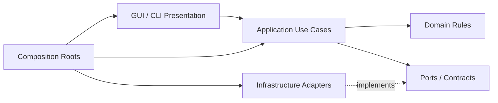
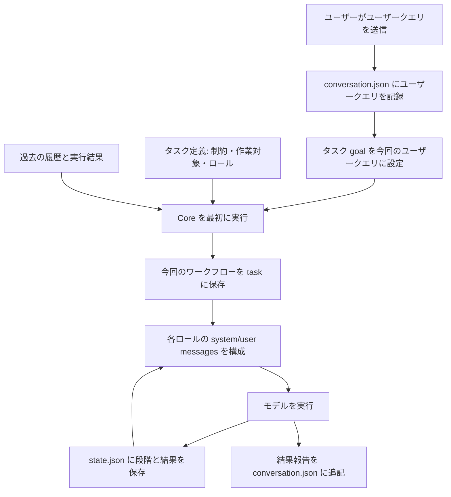

# Ataraxia 技術仕様書

READMEはルートの日本語版 [`README.md`](../README.md) と英語版 [`README/en/README.md`](README/en/README.md) を用意し、冒頭に全言語版へのリンクを示す。表示中の言語は通常のテキスト、他言語版はリンクで表す。ルートREADMEを日本語の正規入口とし、他言語版は `docs/README/<language>/` に配置する。

GUIの会話表示モデルはWPFやfilesystemに依存せず、会話・実行状態と、Composition側で読み込んだロールアイコンgeometryを受け取って表示用項目へ変換する。固定ラベル、ツールチップ、メニュー文言、テーマ選択肢は `GuiLocalizedPresentation.ps1` が翻訳済みの中立な表示データとして返す。WPF View Adapterは表示キーと `Text` / `ToolTip` 等の具体プロパティの対応だけを行い、ContextMenu Adapterも完成済みの文言を受け取る。会話／設定ページとプロジェクトドロワーの表示状態は `GuiNavigationState.ps1` の画面非依存状態モデルで解決し、WPFイベントはアクションを渡し、返された真偽値をView Port経由で各画面へ反映する。タスクパス、編集状態、保留中プロジェクト、ドロワー展開状態は `GuiScreenState.ps1` の明示モデルに集約し、タスクの読み込みとリセットをモデル遷移として扱う。モデル設定欄のloading／dirty／initialized状態は `GuiModelParameterEditorState.ps1` が保持し、プログラムによるモデル一覧更新中に選択イベントを無視する条件と、保存成功時のdirty解除をWPFなしで検証する。GUIエージェント実行の状態遷移、標準出力カーソル、現在のロール、終了コードは `GuiProcessState.ps1` が保持する。`GuiProcessApplication.ps1` は出力ファイル読取Adapterから差分を受け取り、ロール表示、標準エラー表示、終了時の状態解除と一覧更新要否を返す。実行・ロールバックの起動要求を構成し、`PowerShellGuiProcessAdapter.ps1` がPowerShell子プロセスの開始、状態確認、停止、終了、同期実行を担う。標準出力・標準エラーの読み書き・削除は別の出力Adapterに置く。SVG geometry parserはSVG XML文字列を入力値として扱い、ファイル読込はGUI Composition側が担当する。GUIテーマは希望設定（system/light/dark）と実効テーマ（light/dark）を別々に保持し、headless state modelが変更の受理とpalette再適用の要否を決定する。session selectorのプログラム同期状態もheadless modelで管理し、イベントhandlerはその状態を確認してユーザー選択だけをApplication use caseへ渡す。

## 目的

Ataraxia は、ユーザーが定義した作業をローカルで実行する AI エージェントである。**設計は特定のドメインに限定しない。** 調査、執筆、分析、ソフトウェア変更など、分野ごとの処理はタスクの構造化データで定義し、共通の実行基盤で扱う。分野固有の動作は、タスクの目標、制約、ロール、スキーマ、ワークフローに記述する。

エージェントは設定可能な PDCA サイクルを実行する。計画、作業、検証、改善を行い、次に実行する段階を選ぶ。タスク単位でロールやワークフロー段階を追加、変更、削除でき、共通の実行スクリプトを変更する必要はない。

ユーザーが管理する製品成果・制約の宣言的な要求は [`REQUIREMENTS.md`](REQUIREMENTS.md) に記録する。ユーザーは直接編集するか、明示的にエージェントへ追加・変更・削除を指示する。エージェントはその要求から開発計画を組み立て、順次実行できる。本仕様書は技術的な用語・動作・構造を定め、要求の変更権限や受け入れ基準は宣言的要求資料が持つ。

## 用語定義

本文では次の用語を標準表記として使う。同じ概念に別の日本語名を重ねて使わず、コード、設定、保存ファイルを示す場合は対応する識別子を併記する。

| 用語 | 定義 | 対応する識別子・保存先 | 表記規則 |
| --- | --- | --- | --- |
| プロジェクト | タスクとセッションをまとめるデータの単位。 | `projects/<project_name>/`、`project_name` | データの所属先を指す場合は「プロジェクト」とする。 |
| 実行設定 | 起動時に共有設定と選択中のプロジェクトを指定する設定ファイル。 | `configs/config.json` | この設定ファイルを指す場合は「実行設定」とする。 |
| タスク | セッション内でユーザークエリを実行するための構造化された定義。現在のユーザークエリ、制約、作業対象、利用可能ロールと、Core が決めたワークフローを保持する。タスクはユーザークエリそのものや会話履歴ではない。 | `*.task.json`、`goal`、`constraints`、`working_directory`、`roles`、`workflow` | 実行定義を「タスク」、ユーザー入力を「ユーザークエリ」と呼び分ける。 |
| セッション | プロジェクト内で、ひとつのタスク定義、複数のユーザークエリと結果報告からなる会話履歴、ワークフロー実行状態、作業対象をまとめて保持する単位。 | `sessions/<session_id>/`、`session.json`、`conversation.json`、`state.json` | 一連のユーザークエリと実行履歴を束ねる単位を「セッション」とする。 |
| ユーザークエリ | ユーザーが一回の送信でエージェントに実行させる内容。送信ごとに新しいユーザークエリとして会話履歴へ追加し、タスクの `goal` に現在の内容を設定する。直前のユーザークエリを編集して再送した場合は新規追加せず、直前のユーザークエリ以降の履歴を分岐として置き換える。 | `conversation.json` の `user_query`、タスクの `goal` | ユーザー入力は「ユーザークエリ」と呼ぶ。「依頼」「指示」「プロンプト」はユーザー入力の名称に使わない。 |
| プロンプト | 特定のロールを一度実行するためにモデルへ送る入力。システムプロンプト、ロール用に選択・整形した JSON 入力、必要なメディアを Chat API の `messages` として構成する。ユーザークエリはプロンプトを構成する情報の一部であり、両者を同一視しない。 | Chat API `messages[]`、`role`、`content` | モデルに送る入力全体を「プロンプト」、ユーザーの一回の送信を「ユーザークエリ」と呼ぶ。 |
| システムプロンプト | ロールの動作、制約、出力形式をモデルに指示する固定文。プロンプトを構成する一要素。 | `data/default-user/sysprompt/*.json`、`system_prompt` | 固定指示文は「システムプロンプト」とする。 |
| ロール | 入力スキーマに従って情報を受け取り、出力スキーマに従って結果を返す担当機能。 | `roles[]`、`role_id` | 担当機能は「ロール」とする。「役割」と混在させない。 |
| 入出力スキーマ | ロールへ渡す JSON 項目と、ロールが返す JSON 項目の名前・型・制約を定める定義。 | `input_schema`、`output_schema`、`configs/role-contracts.json` | ロールの入力・出力形式は「入出力スキーマ」とする。 |
| ワークフロー | タスクを完了するためのロール実行順序と遷移条件。 | `workflow`、`workflow.stages` | 全体の処理手順を指す場合は「ワークフロー」とする。 |
| ワークフロー段階 | ワークフロー内でロールを実行し、結果を記録して次の遷移を決める単位。 | `workflow.stages[].id`、`phase` | 個々の処理単位は「段階」とする。「ステージ」「フェーズ」は使わない。ただしコード識別子は原表記を保つ。 |
| 作業対象 | エージェントが読み書きする、タスクで指定されたディレクトリとその配下のファイル。 | `working_directory`、`workspace_files` | ディレクトリとファイル群は「作業対象」とする。「ワークスペース」と混在させない。 |
| 文脈 | ユーザークエリを処理するためにロールへ渡すタスク情報と、これまでに蓄積した結果。 | `context`、`results`、`context_summary` | ロールが参照する蓄積情報は「文脈」とする。 |
| 実行状態 | ワークフローの現在位置と、これまでのロール結果・結果報告を保存したデータ。 | `state.json`、`state.history` | 保存された進行情報は「実行状態」とする。「状態ファイル」と書く場合も対象は `state.json` とする。 |
| 差分 | 作業対象の変更前後を表す、適用・検証可能な変更操作。 | `file_changes[]`、`retain`、`delete`、`insert` | ファイル変更の単位は「差分」とする。 |
| 結果報告 | ロールの実行結果をユーザーに伝える見出しと本文。 | `report.heading`、`report.body` | ユーザー向けの見出しと本文は「結果報告」とする。 |
| 表示言語 | ユーザーが画面や結果報告で認識する言語。 | `user_output_language`、`interface_language` | ユーザー向け言語は「表示言語」とする。 |
| 内部言語 | ロール間で内部情報を扱う際の言語。 | `internal_language` | 内部処理に使う言語は「内部言語」とする。 |

## 起動方法とプロジェクトデータ

| 構成要素 | 役割 |
| --- | --- |
| `Ataraxia.exe` | Windows GUI 用の薄い起動ラッパー。PowerShell を検出して引数を `scripts/Start-AtaraxiaGui.ps1` に渡す。PowerShell やランタイムは同梱しない。 |
| `launcher/AtaraxiaLauncher.cs` | 起動ラッパーのソースコード。Windows 標準の .NET Framework のみを使う。 |
| `tools/Build-Ataraxia.ps1` | Windows 標準の .NET Framework C# コンパイラーで、複数サイズのアイコンを埋め込んだ `Ataraxia.exe` を再生成する。 |
| `scripts/Invoke-Agent.ps1` | タスクの作成、実行、再開 |
| `scripts/AgentCore.ps1` | タスクテンプレート、ワークフロー設計結果の組み立て、phase input の投影 |
| `scripts/AgentWorkflow.ps1` | ワークフロー段階の解決、次候補の投影、遷移結果による状態更新 |
| `scripts/AgentRoleExecution.ps1` | Role/Prompt構成、LLM呼び出し、トークン計測、文脈圧縮、出力検証と再試行 |
| `scripts/AgentState.ps1` | 実行状態の検証と、Workspace Store経由の状態保存 |
| `scripts/AgentValidation.ps1` | 実行設定とタスク定義の境界検証 |
| `scripts/TaskExecutionLock.ps1` | タスクディレクトリ単位で実行・再開・ロールバックを排他 |
| `scripts/AgentHarness.ps1` | 指定された作業対象の読み込み、差分の検証、許可リストにあるコマンドの実行 |
| `scripts/WorkspaceDiff.ps1` | 行単位の構造化差分とハッシュの作成・検証 |
| `scripts/Start-AtaraxiaGui.ps1` | タスク作成、ワークフロー実行、結果報告の確認、直前のユーザークエリの編集を行う Windows GUI |
| `scripts/KoboldCppApi.ps1` | ローカルの KoboldCpp API によるトークン数の計測 |
| `scripts/KoboldCppSettings.ps1` | KoboldCpp 共通設定の読み込みと起動引数の作成 |
| `scripts/Initialize-KoboldCpp.ps1` | 任意の KoboldCpp 取得・初期化処理 |

共通スクリプトは `scripts/`、共有設定は `configs/`、表示言語の定義は `locales/` に置く。既定のプロジェクトデータは `projects/Ataraxia/` に保存し、`configs/config.json` の `project_name` で対象名を選択する。

同一タスクの実行、再開、ロールバックは、タスクディレクトリの `.ataraxia-run.lock` を排他オープンしている間だけ許可する。すでに他プロセスが保持している場合は処理を開始せずエラーにする。ロックファイルは空のまま残り、OSがハンドルを解放するため、プロセス異常終了後も次回の実行を妨げない。この排他は同じタスクを対象にするAtaraxiaプロセス間に適用される。異なるタスクが同じ作業対象ディレクトリを共有する場合や、外部ツールによる変更は調整しない。

`Ataraxia.exe` は配置場所を基準に GUI スクリプトを呼び出す。PowerShell 7 を優先し、見つからない場合は PATH または PATH の既定位置から Windows PowerShell を使う。Windows PowerShell 5.1 でも日本語を正しく解釈できるよう、実行される PowerShell スクリプトは UTF-8 BOM 付きで保存する。起動時のスプラッシュには `assets/splash/ataraxia-project-cover.png` を中央に表示し、最低 1.1 秒でメイン画面へ切り替える。`-NoSplash` を指定すると省略する。起動引数は GUI スクリプトへそのまま転送するため、`-ConfigPath` も指定できる。WPFウィンドウとタスクバーのアイコンは `assets/branding/ataraxia-app-icon.png` を直接読み込み、実行ファイルには同画像から生成したICOを埋め込む。エラー時にダイアログは表示せず、例外、呼出位置、スタックトレースをUTF-8ログへ保存する。GUI稼働中はステータス欄にログの場所を表示する。起動異常終了時のログには選択したPowerShellのパス、終了コード、標準出力、標準エラーを含める。ログは `%LOCALAPPDATA%\Ataraxia\logs` に作成し、書込できない場合は `%TEMP%\Ataraxia\logs` を使う。ラッパーは GUI スクリプトや PowerShell ランタイムを埋め込まず、追加のライブラリ依存を導入しない。ブランド画像と実行ファイル用アイコンは `assets/branding/`、ロールアイコンは `assets/role-icons/` に置く。画像はロゴと同じ古典的なセリフ体の大文字 A を使う。ソース変更後は `tools/Build-Ataraxia.ps1` でICOと実行ファイルを再生成する。

GUIインスタンスは、設定ファイルの絶対パスを大文字小文字を区別しないWindowsパスとして正規化した値ごとに、Windowsの対話セッション内で一つだけ許可する。同じ設定ファイルで再度起動したプロセスは新しい画面を作らず、既存インスタンスへ起動通知を送り、正常終了する。既存画面は最小化されていれば復元し、前面化を要求する。起動通知は既存画面の初期化中も失われない名前付き自動リセットイベントで受け渡し、GUIのディスパッチャー周期処理で消費する。異なる設定ファイルは別インスタンスとして起動できる。二回目の起動で渡された設定や起動オプションは既存インスタンスに適用しない。Mutexと通知イベントはGUIプロセスの寿命に合わせて保持・解放し、異常終了時はOSによるハンドル解放後に再起動を許可する。このGUI単一起動制御は、タスク実行時の `.ataraxia-run.lock` とは独立しており、GUI以外からの同一タスク重複実行防止にも影響しない。

## 設計原則と段階的再設計

Ataraxia の内部設計は、変更理由ごとの**高凝集**と、層・機能間の**疎結合**を目指す。ドメイン非依存の要件を保ちながら、責務を小さく明示的なモジュールへ分け、外部サービスやUI基盤の変更が他の機能へ波及しないようにする。抽象化は、外部I/O、環境差、複数の利用者が共有する契約など、変更可能性が実在する境界に設ける。将来の変更可能性だけを理由に汎用フレームワークや重複したラッパーを増やさない。

### 目標とする依存方向

| 層 | 責務 | 依存してよい対象 |
|---|---|---|
| Presentation | CLI引数、WPF表示、入力イベント、表示言語への変換 | Application のユースケースと表示用モデル |
| Application | タスク実行、セッション管理、GUI操作などのユースケースを調整 | Domain と Ports。具体的なアダプターは受け取って使う |
| Domain | ワークフロー、検証、遷移、差分計算などの規則 | Domain 内の値・契約のみ。OS、UI、ネットワーク、ファイルへの依存を持たない |
| Ports | LLM、時刻、ID、永続化、プロセス、設定などの入出力契約 | 共通データ型とDomainの型 |
| Adapters | KoboldCpp、ファイル、OSプロセス、WPF、ローカライズなどの具体的な接続 | 対応するPortと外部基盤 |
| Composition root | 起動時に設定を読み、PortsへAdapterを割り当て、Applicationを開始 | 全層。CLIとGUIの各エントリポイントに置く |

依存性逆転の原則に従い、内側の規則を外側の実装から独立させる。Application は具体的なストレージやHTTPクライアントを生成せず、Port越しに呼び出す。AdapterはPortの契約を満たす。PowerShellでは初期段階として、呼び出し単位に渡す依存オブジェクトとスクリプトブロックをPortとして利用できる。プロセス全体の可変グローバル状態や、テスト時だけの振る舞い分岐を導入しない。

現行GUIでは、Project/Session操作と表示モデルを `scripts/GuiApplication.ps1` に置き、WindowとSplashのXAMLを `scripts/presentation/` に分離している。WPFスクリプトはAdapterを組み立て、返却モデルを描画して入力イベントをつなぐ。Window構造とProject/Session Use CaseはWPFを起動しないヘッドレステストで検証する。イベント結線と長寿命の画面状態は段階的な移行対象であり、詳細を [アーキテクチャ再設計資料](ARCHITECTURE_REDESIGN.md) に記録する。



各モジュールは単一のまとまりある責務を持つ。複数層をまたぐ巨大スクリプト、無関係な関数の共通ユーティリティへの寄せ集め、同じ判断規則の複製を避ける。設定可能な業務方針は構造化設定へ置き、秘密や環境依存値をソースへ埋め込まない。詳しい現状評価、目標モジュール、移行順序は [アーキテクチャ再設計資料](ARCHITECTURE_REDESIGN.md) に定める。

再設計では大規模な一括書き換えを避ける。利用者から見える振る舞いを特性テストで固定してから、機能単位の縦切りで進める。各段階で依存境界を導入し、単体テスト、契約テスト、必要な統合テストを追加して全テストを通す。各段階は独立してレビュー・復旧できる状態にし、旧構造を残す期間と削除条件を明記する。後方互換性は既定で要求しないが、データ移行や破壊的変更の影響はテスト・資料で扱う。

各プロジェクトは `projects/<project_name>/sessions/<session_id>/` に独立したセッションを保存する。セッションには `session.json`、タスク定義、`state.json`、`conversation.json`、専用の作業対象 `workspace/` が含まれる。セッションを切り替えると、そのセッション固有のタスク定義、ユーザークエリ履歴、実行状態を読み戻す。プロジェクトデータはユーザーデータとして扱い、ソース管理から除外する。

左側のプロジェクトドロワーでは、有効なプロジェクトフォルダーの切り替え、新規作成、名前変更を行える。新規作成したプロジェクトは直ちに選択される。切り替えは、選択中の実行設定にある `project_name` だけを更新する。名前変更ではフォルダーを移動し、移動先が使用済みなら拒否する。名前変更したプロジェクトが選択中なら実行設定と読み込み済みタスクのパスも更新する。ワークフロー実行中はプロジェクト操作を無効にする。

## 分野に依存しないワークフロー

`Invoke-Agent.ps1 -New <name>` は、プロジェクトフォルダーに構造化されたタスクひな形を作成する。`-Run <task-path>` はタスクに定義されたワークフローを実行する。`-Step 1` は段階をひとつ実行し、`-Step -1` は終端状態まで続ける。`-Resume` は既存タスクの状態から再開する。

タスクは `goal`、`context`、`constraints`、`working_directory`、`roles`、`workflow` を定義する。新しいユーザークエリの実行では、`core` ロールを必ず最初に呼び出し、そのユーザークエリ、制約、作業対象、過去の結果、利用可能なロールを基に段階と遷移候補を再設計する。段階実行の継続では同じユーザークエリの設計を維持する。Ataraxia は定義済みロールだけが選ばれていること、段階IDと結果キーの一意性、遷移先、初期段階からの到達可能性、完了状態への経路を検証してからタスクへ保存する。実行時のルーターは各段階が宣言した候補から次の段階を選ぶ。ロールは目的、システムプロンプト、入力スキーマ、出力スキーマを持つ。新しいタスクひな形のロール定義は `configs/role-contracts.json` から作成する。旧形式のタスクも初回実行時に Core と Router を補い、次のユーザークエリから Core がワークフローを設計する。以前の状態と結果は保持する。

### タスク・ユーザークエリ・プロンプトのライフサイクル

タスクはセッション内に一つ保存し、ユーザークエリを実行するたびにその `goal` を今回のユーザークエリ本文へ更新する。ユーザークエリ本文そのものと時系列は `conversation.json` に蓄積し、各ロールの結果報告も同じ履歴に記録する。`state.json` は現在のユーザークエリに対する Core の設計、段階位置、結果を保持する。したがって、タスクは実行定義、ユーザークエリはユーザーが送信した内容、プロンプトは各ロールの実行時に構成されるモデル入力であり、保存単位も役割も異なる。

実行中に判断材料やユーザー提供情報が不足した場合、ルーターは通常の次段階や完了に加えて `AwaitUser` を選べる。これはワークフローの終端状態ではなく、実行を中断してユーザークエリを待つ状態である。ここへ遷移する前のロール結果、報告、適用済み差分は保存される。GUI は待機状態を表示し、ユーザーが追加のユーザークエリを送信すると、同じセッションのタスク `goal` を更新して Core から新しいワークフローを設計する。過去の状態と結果を次の Core に渡し、既存の作業対象変更は保持する。単に実行を止める操作は従来どおり差分を復元し、ユーザー判断を待つ中断とは区別する。

現行ワークフローでは進められないものの、追加情報があれば自律的に解決できる場合は、ルーターが `ReplanCore` を選択できる。実行基盤は同じユーザークエリと蓄積済みの結果を保持して Core に戻り、Core は別の段階構成を設計して実行を続ける。ユーザーにしか答えられない判断や不足情報がある場合に限り `AwaitUser` を選ぶ。自律再計画はユーザークエリごとに最大 2 回とし、タスクの `workflow.max_core_replans_per_query` で変更できる。上限後はルーターに再計画を提示せず、利用可能な通常段階またはユーザー待ちを選ばせる。



段階実行の継続（`-Resume` など）は同じユーザークエリの続きとして扱い、Core による再設計を挟まない。ワークフロー完了後または `AwaitUser` 待機中に `-Run` を実行した場合は、新しいユーザークエリ本文が前回と同じでも新しいユーザークエリとして扱い、Core から始める。GUI で直前のユーザークエリを編集して再送した場合は会話履歴の分岐を作り、対応する実行状態も分岐前へ戻して新しいユーザークエリとして Core に渡す。

各ロールには専用の入力スキーマを定義し、担当作業に必要な項目だけを渡す。次の表に、標準ロールの識別子、既定の実行条件、機能、必須入力、必須出力、システムプロンプトを示す。タスク作成者はタスクデータで実行段階を変更できる。実行条件の列は既定ワークフローの内容である。

`core` と `planner` は異なる階層を担当する。Core はワークフロー設計者として、必要なロールとその実行順序・遷移を決める。Planner は計画作成者として、選ばれた場合に実行可能な行動の順序、前提条件、完了基準を作る。Core はタスクの行動計画を作らず、Planner はロール構成やワークフロー遷移を決めない。単純な作業では Core は Planner を省略できる。複数の依存する行動、不確実性、または明示的な計画要求がある場合に Planner を含める。Plan は Planner が実行されるワークフロー段階の識別子の例であり、Planner ロールそのものとは区別する。

| アイコン | ロール名・識別子 | 既定の実行条件 | 機能 | 必須入力項目 | 必須出力項目 | スキーマ・システムプロンプト |
| --- | --- | --- | --- | --- | --- | --- |
|  | ワークフロー設計 / `core` | 新しいユーザークエリの実行時に必ず最初 | 必要なロールと実行順序・遷移を選び、ワークフローを設計する。行動レベルの計画や完了基準は作らない。出力後、許可されたロール、遷移先、到達可能性をコードで検証する。 | `goal`, `context`, `constraints`, `workspace_files`, `workspace_media`, `available_roles`, `user_output_language`, `internal_language` | `workflow`（`initial_stage`, `stages[]`） | 入力 `agent_core_input` → 出力 `agent_core_output`。プロンプト `agent_core.json` |
|  | 計画作成 / `planner` | 複数の依存する行動、不確実性、明示的な計画要求がある場合に Core が選択 | 実行可能な行動を順序化し、前提条件と測定可能な完了基準を作る。ワークフロー段階や担当ロールは決めない。 | `goal`, `context`, `constraints`, `cycle`, `latest_stage`, `results`, `workspace_files`, `context_summary`, `user_output_language`, `internal_language` | `plan`, `actions`, `success_criteria` | 入力 `agent_planner_input` → 出力 `agent_planner_output`。プロンプト `agent_planner.json` |
|  | 調査 / `researcher` | ルーターが選んだ `Research` 段階 | 作業対象のファイルやメディアを調べ、目標に関係する根拠を集める。 | `goal`, `context`, `constraints`, `cycle`, `latest_stage`, `results`, `workspace_root`, `workspace_files`, `workspace_media`, `context_summary`, `user_output_language`, `internal_language` | `findings`, `workspace_sources`, `open_questions` | 入力 `agent_researcher_input` → 出力 `agent_researcher_output`。プロンプト `agent_researcher.json` |
|  | 作業 / `executor` | ルーターが選んだ `Do` 段階 | 検証可能なファイル差分と、許可リストにあるコマンドを提案する。 | `goal`, `context`, `constraints`, `cycle`, `phase`, `phase_data`, `latest_stage`, `results`, `workspace_root`, `workspace_files`, `workspace_media`, `allowed_commands`, `context_summary`, `user_output_language`, `internal_language` | `result`, `file_changes`, `commands`, `status` | 入力 `agent_executor_input` → 出力 `agent_executor_output`。プロンプト `agent_executor.json` |
|  | レビュー / `reviewer` | `Check` 段階 | 適用された変更とコマンドの根拠を目標・完了条件と照合する。 | `goal`, `context`, `constraints`, `cycle`, `phase`, `phase_data`, `latest_stage`, `results`, `workspace_root`, `workspace_files`, `workspace_media`, `context_summary`, `user_output_language`, `internal_language` | `approved`, `findings`, `next_actions` | 入力 `agent_reviewer_input` → 出力 `agent_reviewer_output`。プロンプト `agent_reviewer.json` |
|  | 改善 / `improver` | レビュー後の `Act` 段階 | レビュー指摘を修正内容と次の計画にまとめる。 | `goal`, `context`, `constraints`, `cycle`, `phase`, `phase_data`, `latest_stage`, `results`, `workspace_files`, `context_summary`, `user_output_language`, `internal_language` | `changes`, `next_plan` | 入力 `agent_improver_input` → 出力 `agent_improver_output`。プロンプト `agent_improver.json` |
|  | 次段階の選択 / `router` | ワークフロー段階間の `Route` 段階 | 記録済みの根拠を基に、許可された次段階または終端状態を選ぶ。 | `goal`, `context`, `constraints`, `cycle`, `phase`, `phase_data`, `latest_stage`, `results`, `available_next_stages`, `context_summary`, `user_output_language`, `internal_language` | `next_stage`, `rationale` | 入力 `agent_router_input` → 出力 `agent_router_output`。プロンプト `agent_router.json` |
|  | 検証 / `verifier` | ルーターが選んだ `Verify` 段階 | 各完了条件が作業対象とコマンドの根拠によって満たされたか確認する。 | `goal`, `context`, `constraints`, `cycle`, `phase`, `phase_data`, `latest_stage`, `results`, `workspace_root`, `workspace_files`, `workspace_media`, `context_summary`, `user_output_language`, `internal_language` | `verified`, `findings`, `evidence` | 入力 `agent_verifier_input` → 出力 `agent_verifier_output`。プロンプト `agent_verifier.json` |
|  | セキュリティ確認 / `security_reviewer` | ルーターが選んだ `Audit` 段階 | 提案または適用された変更から具体的なリスクを特定し、対策を示す。 | `goal`, `context`, `constraints`, `cycle`, `phase`, `phase_data`, `latest_stage`, `results`, `workspace_root`, `workspace_files`, `workspace_media`, `context_summary`, `user_output_language`, `internal_language` | `risk_level`, `findings`, `required_actions` | 入力 `agent_security_reviewer_input` → 出力 `agent_security_reviewer_output`。プロンプト `agent_security_reviewer.json` |
|  | 影響評価 / `impact_reviewer` | 計画後、ルーターが必要と判断した場合の `Impact` 段階 | 実装前に互換性、既存データ、依存関係、利用者への影響、可逆性を確認し、対策を提案する。セキュリティ監査とは分け、機能的・運用的な影響を扱う。 | `goal`, `context`, `constraints`, `cycle`, `phase`, `phase_data`, `latest_stage`, `results`, `workspace_root`, `workspace_files`, `context_summary`, `user_output_language`, `internal_language` | `impact_level`, `affected_areas`, `findings`, `mitigations`, `reversible` | 入力 `agent_impact_reviewer_input` → 出力 `agent_impact_reviewer_output`。プロンプト `agent_impact_reviewer.json` |
|  | 文脈圧縮 / `context_compressor` | 計測した入力が設定済みのしきい値またはコンテキスト上限を超えた場合 | 判断、要件、根拠、未解決項目を保って文脈を短縮する。 | `goal`, `context`, `constraints`, `latest_stage`, `results`, `target_tokens`, `user_output_language`, `internal_language` | `compressed_context`, `retained_facts`, `open_items` | 入力 `agent_compressor_input` → 出力 `agent_compressor_output`。プロンプト `context_compressor.json` |
|  | 結果報告 / `reporter` | 結果報告ロール自身を除く各ワークフローロールの完了後 | ロールの結果を、見出しと読みやすい本文にまとめる。 | `goal`, `phase`, `latest_stage`, `results`, `user_output_language`, `internal_language` | `heading`, `body` | 入力 `agent_reporter_input` → 出力 `agent_reporter_output`。プロンプト `reporter.json` |
|  | セッション命名 / `session_namer` | 新しいセッションで最初のユーザークエリを受けた後、ワークフロー開始前に一度 | 設定された表示言語で短いセッション名を作る。ユーザーが変更した名前は自動で上書きしない。 | `first_prompt`, `user_output_language`, `internal_language` | `title` | 入力 `session_namer_input` → 出力 `session_namer_output`。プロンプト `session_namer.json` |

スキーマ名は `configs/role-contracts.json` 内の定義を参照し、システムプロンプトは `data/default-user/sysprompt/` に置く。実行時に共通のワークフローデータから各ロールの入力項目を選び、送信前に検証する。受信した JSON も各ロールの出力スキーマで検証し、未定義の出力項目を拒否する。

標準ロールは分野に依存しない再利用可能な例である。タスクデータでは分野固有のロールも定義できる。新しいセッションの最初のユーザークエリを受けると、セッション命名ロールが設定された表示言語で簡潔な名前を作り、セッション情報に保存する。ユーザーが名前を変更した場合、自動命名では上書きしない。

## 作業対象の変更とコマンド

作業ロールは相対パス、操作、変更前の SHA-256 ハッシュ、`retain` / `delete` / `insert` 操作からなる `file_changes[]` を返す。Ataraxia は適用前に各差分を対象ファイルとハッシュに照らして検証する。タスクの `working_directory` の外に出るパス、再解析ポイントを経由するパス、重複したパス、不一致のハッシュ、削除対象行が一致しない差分は拒否する。絶対パス、上位・カレントディレクトリ参照、制御文字、Windows の予約名や不正なパス要素も拒否し、1段階あたりの変更ファイル数と各差分の操作数に上限を設ける。適用するテキストは UTF-8 として検証し、NUL や許可されない制御文字、過大な内容を拒否する。

コマンドは `configs/agent-harness.json` の許可設定に、実行ファイルと引数が一致した場合だけ実行する。タスク内のユーザークエリやモデル出力から許可項目を追加することはできない。引数は文字列配列とし、個数・長さ・改行を検証する。標準出力・標準エラーは ANSI 制御列と危険な制御文字を除き、長さを制限してからタスク状態へ記録する。HTTP 通信先は絶対 HTTP(S) URI、エンドポイントは許可文字とパス要素を検証する。

設定、タスク、セッション情報、会話履歴などの JSON ファイルは UTF-8 として読み込み、既定で 4 MiB を上限とする。状態ファイルは 2 MiB、差分ジャーナルは 8 MiB を上限とする。LLM 応答 JSON は 1 MiB を上限とし、JSON 本体だけを受け付ける（単独の JSON コードフェンスは許可）。JSON Schema の型、必須項目、追加項目、長さ、配列数、数値範囲、正規表現をローカルで検証し、テキストの Unicode と制御文字も確認する。プロンプトの適合判定に文字数上限を使わない。ユーザークエリ、タスク文脈、ロール指示、プロジェクト・セッション共通プロンプトを含む実際の system/user メッセージ全体を KoboldCpp のトークン計数 API で計測し、応答予約分を加えたコンテキスト上限と比較する。超過時の分割位置もトークン計数を使って決め、文脈圧縮ロールで再試行する。ファイル読込のバイト上限はプロンプト長制限とは別の破損・過大入力保護である。差分は1段階あたり100ファイル、各ファイル5,000操作、変更対象ファイル1 MiBを上限とし、差分ジャーナル全体にも上限を適用する。コマンドは1段階64件、引数は64個・各4,096文字まで、出力は標準出力・標準エラーごとに20,000文字まで記録する。これらの検証は入力・LLM 応答・ファイル差分・コマンド出力の各境界で行う。

### JSON構造カタログ

この節はAtaraxiaが生成・読込・送信・受信するJSONの規範的な構造定義である。JSONのキーは大文字・小文字を区別する。以下の型表記はJSON型を表し、`?` は省略可能、`[]` は配列、`{string: T}` は任意の文字列キーから型 `T` へのオブジェクトを表す。特に追加可能と記した箇所を除き、規定されたキー以外は受け付けない。値の範囲、文字列上限、配列上限などは本節の下に記す検証規則も適用する。

#### 永続JSONファイル一覧

| ファイル・場所 | ルート型 | 用途・対応する構造 |
|---|---|---|
| `configs/config.json`、`config.example.json`、利用者指定設定 | object | 実行設定。下記「実行設定」 |
| `configs/koboldcpp-settings.json`、`koboldcpp_settings_path` の参照先 | object | KoboldCppの共有起動・生成設定。下記「KoboldCpp設定」 |
| `configs/model-parameter-presets.json` | object | Git管理する内蔵モデル系列プリセット。下記「モデルパラメータプリセット」 |
| `%LOCALAPPDATA%/Ataraxia/model-parameter-presets.json` | object | 利用者が作成・変更するプリセットと選択状態。Git管理外 |
| `configs/agent-harness.json` | object | 作業対象読込制限と外部コマンド許可設定。下記「ハーネス設定」 |
| `configs/role-contracts.json` | object | JSON Schema辞書とロール定義。下記「ロール契約」 |
| `configs/gui-dialog-contracts.json` | object | ダイアログ入出力契約。下記「GUIダイアログ契約」 |
| `configs/gui-themes.json` | object | GUIライト／ダークテーマの色パレット。下記「GUIテーマ色」 |
| `locales/ja.json`、`locales/en.json` | object | ローカライズキーから文字列への辞書 |
| `data/<resource-user>/sysprompt/<name>.json` | object | システムプロンプト文書。`name` と `content` を持つ |
| `projects/<project>/project.json` | object | プロジェクトメタデータ。下記「プロジェクト・セッション」 |
| `projects/<project>/sessions/<session>/session.json` | object | セッションメタデータ。下記「プロジェクト・セッション」 |
| `projects/<project>/sessions/<session>/<session>.task.json` | object | タスク定義。下記「タスクとワークフロー」 |
| `projects/<project>/sessions/<session>/state.json` | object | ワークフロー実行状態。下記「実行状態」 |
| `projects/<project>/sessions/<session>/conversation.json` | object | ユーザークエリ履歴。下記「会話履歴」 |
| `projects/<project>/sessions/<session>/request-transaction.json` | object | GUIクエリ保存中の回復ジャーナル。下記「クエリ更新ジャーナル」 |
| `projects/<project>/sessions/<session>/run-changes.json` | object | 実行中の差分と復元用スナップショット。下記「差分ジャーナル」 |

#### GUIテーマ色

`configs/gui-themes.json` はテーマ色を提供するソース管理対象の静的データであり、利用者設定の `gui_theme` は選択状態だけを保持する。ルートobjectの全構造は次のとおり。`schema_version` は整数 `1` 固定、`themes` は `light` と `dark` の両方を必須とする。各パレットは次の10キーを過不足なく持ち、色は `#RRGGBB` 形式の6桁16進数とする。未知のキー、欠落、形式不正、未対応schema versionは拒否する。

```json
{
  "schema_version": 1,
  "themes": {
    "light": {
      "app_background": "#RRGGBB", "surface": "#RRGGBB",
      "panel": "#RRGGBB", "drawer": "#RRGGBB",
      "primary_text": "#RRGGBB", "secondary_text": "#RRGGBB",
      "border": "#RRGGBB", "accent": "#RRGGBB",
      "accent_text": "#RRGGBB", "icon": "#RRGGBB"
    },
    "dark": {
      "app_background": "#RRGGBB", "surface": "#RRGGBB",
      "panel": "#RRGGBB", "drawer": "#RRGGBB",
      "primary_text": "#RRGGBB", "secondary_text": "#RRGGBB",
      "border": "#RRGGBB", "accent": "#RRGGBB",
      "accent_text": "#RRGGBB", "icon": "#RRGGBB"
    }
  }
}
```

GUI Composition rootがこのJSONを一度読み込む。`GuiTheme.ps1` は注入された値を検証して選択中テーマの値モデルを返し、`adapters/WpfThemeAdapter.ps1` はその完成済みパレットをWPFリソースへ適用する。パレットの色設計は無彩色とし、通常文字と背景は輝度比7以上、入力欄の副次文字と背景は4.5以上を満たす。

#### 実行設定

ルートはobject。`config.example.json` の全キーは次のとおり。利用者設定では各キーを必要に応じて省略でき、未知の設定キーも読み込み時には保持する。

| キー | 型 | 意味・制約 |
|---|---|---|
| `api_type` | string | 接続種別。現在は `koboldcpp` |
| `api_server` | string? | 旧形式互換の絶対HTTP(S) URI |
| `generate_path` | string? | 旧形式互換の生成APIパス |
| `override` | object? | 旧形式の生成パラメータ。指定時は正の整数 `context_size` と `max_tokens` または `max_completion_tokens` が必要。その他のKoboldCpp要求パラメータも保持する |
| `koboldcpp` | object? | 旧形式のKoboldCppパス設定 |
| `koboldcpp_settings_path` | string | KoboldCpp設定ファイルへの絶対パス、またはこの設定ファイルのディレクトリからの相対パス |
| `role_contracts_path` | string | ロール契約ファイルへの絶対パス、または設定ファイルからの相対パス |
| `agent_harness_path` | string | ハーネス設定ファイルへの絶対パス、または設定ファイルからの相対パス |
| `project_name` | string | `[A-Za-z0-9][A-Za-z0-9_-]{0,63}` に一致するプロジェクト名 |
| `resources_root` | string | 追加リソースのルート。空文字列を許可 |
| `resources_user` | string | システムプロンプト等のリソースユーザー名 |
| `json_retry_limit` | integer? | JSON解析または出力Schema不一致時の再試行回数。`-1` は無制限、それ以外は0以上 |
| `context_compression` | object? | `enabled:boolean`、`trigger_tokens:integer`、`target_tokens:integer`、`role_id:string`。`enabled=true` の場合、後三項目を必須としトークン値は正数 |
| `llm_input_format` | string | `json` または `markdown` |
| `json_pretty` | boolean | モデル入力JSONの字下げを有効化 |
| `json_indent` | integer | 0から8までの字下げ幅 |
| `interface_language` | string | GUI言語。`Japanese` または `English` |
| `gui_theme` | string | `system`、`light`、`dark` |
| `gui` | object | `recent_sessions_max:integer`（1以上） |
| `user_output_language` | string | ユーザー向け出力言語 |

#### KoboldCpp設定

ルートobjectの構造は次のとおり。`startup_parameters` はKoboldCpp共通起動引数、`request_parameters` は選択中プリセットのChat Completion値である。プリセット配列と選択IDは別のプリセットデータファイルに保存し、このファイルには含めない。

```json
{
  "server": { "host": "string", "port": "integer", "generate_path": "string" },
  "paths": {
    "install_directory": "string", "model_directory": "string",
    "model_file": "string", "executable": "string"
  },
  "startup_parameters": [{ "name": "string", "value": "scalar?" }],
  "request_parameters": {
    "context_size": "integer", "max_tokens": "integer",
    "temperature": "number", "top_p": "number", "top_k": "number",
    "presence_penalty": "number", "frequency_penalty": "number",
    "repetition_penalty": "number", "seed": "integer", "stop": ["string"]
  },
  "release_tag": "string?",
  "sha256": "string?"
}
```

`server.port` は1から65535、`server.host` はホスト名またはIPアドレス、`generate_path` は絶対パス形式である。`startup_parameters[]` の `name` は英字で始まる英数字・`_`・`-`、`value` は省略可能なJSONスカラーで、`model`、`port`、`contextsize` は予約済み。`request_parameters` は追加のKoboldCppスカラー設定を許可するが、Ataraxiaが編集する既知数値キーは画面側の範囲検証を通す。`stop` は文字列配列。

`request_parameters` はKoboldCppが受け付ける追加のスカラー設定キーも保持できる。Ataraxiaが編集する既知数値キーは画面側の範囲検証を通す。プリセットは「モデルパラメータプリセット」ファイルから合成して使う。モデルファイルと同じstemのJSONは一切読み込まず、起動・生成パラメータを上書きしない。モデルstemのJSONファイルが存在しても変更・削除しない。

#### モデルパラメータプリセット

プリセットの選択と生成値は全プロジェクト・全モデルで共通である。モデル選択時の自動切替は行わない。GUIの内蔵・個人プリセットは、Git管理カタログと利用者データを実行時に統合する。

Git管理カタログ `configs/model-parameter-presets.json` の全構造は次のとおり。

```json
{
  "schema_version": 1,
  "presets": [{
    "id": "string", "name": "string", "name_en": "string", "family": "string",
    "purpose": "string", "model_examples": ["string"],
    "source_url": "absolute HTTPS URL",
    "request_parameters": {
      "context_size": "integer", "max_tokens": "integer",
      "temperature": "number", "top_p": "number", "top_k": "integer",
      "presence_penalty": "number", "frequency_penalty": "number",
      "repetition_penalty": "number", "seed": "integer", "stop": ["string"]
    }
  }]
}
```

利用者データ `%LOCALAPPDATA%/Ataraxia/model-parameter-presets.json` の全構造は次のとおり。`overrides[]` は内蔵プリセットに対する利用者独自の名前と旧版で保存された値を保持する。現行GUIは値のoverrideを新規作成せず、値の変更は別の利用者プリセットへ保存する。既存の値overrideは読み込み時に維持される。

```json
{
  "schema_version": 1,
  "active_preset_id": "string",
  "presets": [{
    "id": "string", "name": "string",
    "request_parameters": {
      "context_size": "integer", "max_tokens": "integer",
      "temperature": "number", "top_p": "number", "top_k": "integer",
      "presence_penalty": "number", "frequency_penalty": "number",
      "repetition_penalty": "number", "seed": "integer", "stop": ["string"]
    }
  }],
  "overrides": [{
    "id": "built-in preset ID", "name": "string?",
    "request_parameters": "request_parameters object?"
  }],
  "pending_shared_settings": {
    "schema_version": 1,
    "request_parameters": "request_parameters object"
  }
}
```

両ファイルの `request_parameters` は同じキーと型を持ち、既知キー以外のKoboldCpp要求値も許容する。プリセットIDは空でなく、制御文字を含まず、128文字以下で一意とする。名前は前後空白を除去した後に1〜64文字で制御文字を含まず、大文字小文字を区別せず一意とする。`active_preset_id` は統合後の配列内IDを参照する。ユーザープリセットの追加・値変更・改名・削除と選択状態は利用者データだけへ保存する。内蔵プリセットの値は上書き・削除できず、選択中は上書き保存ボタンと削除ボタンを無効にする。内蔵値を調整して保持する場合は「別名で保存」で独立した利用者プリセットを作る。最後の利用可能プリセットは削除できない。初回移行では従来の共有 `request_parameters` とプリセットを利用者データへ複写し、既存値を温存する。`ATARAXIA_USER_DATA_DIRECTORY` が指定される場合は、そのディレクトリを利用者保存先として使う。

GUIがプリセット利用者データと共有KoboldCpp設定を続けて保存する際、先に利用者データを原子的に保存し、その後に共有設定を保存する。共有設定の保存に失敗したときは、利用者データへ任意の `pending_shared_settings` を追加して、直前の選択値を共有設定へ適用する必要があることを記録する。次回 `Import-KoboldCppSettings` でこの記録を検証し、`request_parameters` を含む共有設定を原子的に保存する。成功した場合のみジャーナルを利用者データから除去する。復旧保存が失敗した場合はジャーナルを保持し、次回起動時に再試行する。`pending_shared_settings` は `{schema_version:1, request_parameters:object}` であり、通常操作はこれを作成・編集しない。これは2ファイルをまたぐトランザクションの未完了状態を示す回復記録である。

内蔵プリセットはモデル提供元の公式推奨値または配布 `generation_config.json` を基準にする。`context_size=8192`、`max_tokens=2048`、各ペナルティの中立値、`seed=-1`、空の`stop`など、根拠資料にない値は共通の初期値として補完し、系列の公式推奨値とは扱わない。`min_p`など現行GUIに編集欄がない値は含めない。初期カタログの対象と根拠は次のとおり。

| 系列・プリセット | 推奨値の出典 |
|---|---|
| Qwen 3.5 Instruct・Thinking・精密コーディング | [Qwen 3.5 9B Best Practices](https://huggingface.co/Qwen/Qwen3.5-9B) |
| Llama 4 Instruct | [Meta公式 Llama 4 生成実装](https://github.com/meta-llama/llama-models/blob/main/models/llama4/generation.py) |
| Gemma 4 Instruct | [Google公式 Gemma 4 generation_config.json](https://huggingface.co/google/gemma-4-12B-it/blob/main/generation_config.json) |
| Mistral Small 3.2 Instruct | [Mistral公式 generation_config.json](https://huggingface.co/mistralai/Mistral-Small-3.2-24B-Instruct-2506/blob/main/generation_config.json) |
| DeepSeek R1 推論 | [DeepSeek R1公式推奨](https://huggingface.co/deepseek-ai/DeepSeek-R1) |

#### ハーネス設定

```json
{
  "workspace": {
    "max_file_bytes": "integer", "max_total_bytes": "integer",
    "max_media_bytes": "integer", "max_total_media_bytes": "integer",
    "media_extensions": ["string"], "ignored_directories": ["string"]
  },
  "allowed_commands": [{
    "id": "string", "executable": "string",
    "arguments_regex": "string", "timeout_seconds": "integer"
  }]
}
```

各許可コマンドの `id` は一意。実行可能ファイル、引数全体に一致する正規表現、正のタイムアウトを一組として固定し、タスクやモデル出力から許可項目を追加できない。読込上限はJSONのサイズ上限とは別に適用する。

#### ロール契約、JSON Schema、モデル出力

`role-contracts.json` は `{ "schemas": {<schema-id>: <JSON Schema>}, "generic_agent": { "roles": [<role>] } }` を持つ。ロールは `id:string`、`system_prompt:string`、`purpose:string`、`input_schema_ref:string`、`output_schema_ref:string`、`message_structure:{"roles":["system"|"user"|"assistant"|"developer"]}` を持つ。Schema辞書の各定義は`type`、`properties`、`required`、`items`、`enum`、`anyOf`、`additionalProperties`、`minItems`、`maxItems`、`minimum`、`maximum`、`minLength`、`maxLength`、`pattern` を必要に応じて使う。Ataraxiaが解釈する型は `object`、`array`、`string`、`boolean`、`integer`、`number`、`null`。Schema参照またはインラインSchemaでタスク内ロールを定義する。

ロールへ送る共通入力のJSON型は、`goal/context/phase/latest_stage/user_output_language/internal_language:string`、`constraints:string[]`、`cycle/target_tokens:integer`、`results:object`、`phase_data/context_summary:object|null`、`workspace_root:string`、`workspace_files/workspace_media/allowed_commands/available_next_stages:object[]`。各ロールが受け取る必須項目の選択は本書のロール一覧表に従う。`workspace_files[]` は `{path:string, sha256:string, byte_length:integer, content_available:boolean, content:string}`、`workspace_media[]` は `{path:string, mime_type:string, sha256:string, byte_length:integer}`、許可コマンド要素は `{id:string, executable:string, arguments_regex:string}`、利用可能ロール要素は `{id:string, purpose:string}`、次段階候補要素は `{id:string, role_id:string, purpose:string}`。これらの要素は各記載フィールドを必須とし、追加キーを禁止する。

モデル出力オブジェクトの必須構造は次のとおり。全ての出力Schemaで未定義の追加プロパティは禁止する。

| ロール | 必須出力キーと型 |
|---|---|
| `core` | `workflow:{initial_stage:string, stages:[{id:string, role_id:string, result_key:string, next_stages:string[]}]}`。段階数は1から16、各段階の`next_stages`は1件以上 |
| `planner` | `plan:string`, `actions:string[]`, `success_criteria:string[]` |
| `executor` | `result:string`, `file_changes:object[]`, `commands:object[]`, `status:string`。`status`は`completed`、`blocked`、`partial` |
| `reviewer` | `approved:boolean`, `findings:string[]`, `next_actions:string[]` |
| `improver` | `changes:string[]`, `next_plan:string` |
| `router` | `next_stage:string`, `rationale:string` |
| `researcher` | `findings:string[]`, `workspace_sources:string[]`, `open_questions:string[]` |
| `verifier` | `verified:boolean`, `findings:string[]`, `evidence:string[]` |
| `security_reviewer` | `risk_level:string`（`none`、`low`、`medium`、`high`、`critical`）, `findings:string[]`, `required_actions:string[]` |
| `impact_reviewer` | `impact_level:string`（`low`、`medium`、`high`）, `affected_areas:string[]`, `findings:string[]`, `mitigations:string[]`, `reversible:boolean` |
| `context_compressor` | `compressed_context:string`, `retained_facts:string[]`, `open_items:string[]` |
| `reporter` | `heading:string`, `body:string` |
| `session_namer` | `title:string` |

`file_changes[]` は `{path:string, action:"create"|"modify"|"delete", base_hash:string, operations:[operation]}`。`base_hash` は64桁のSHA-256。operationは `{op:"retain", count:integer, lines:string[]}`、`{op:"delete", count:integer, lines:string[]}`、`{op:"insert", count:integer, lines:string[]}` のいずれか。`commands[]` は `{command_id:string, arguments:string[]}`。コマンドIDはハーネス許可表に存在する必要がある。作業変更は段階ごと100ファイル、各ファイル5,000操作、変更後ファイル1 MiBを上限とする。

#### タスクとワークフロー

`*.task.json` はJSON objectで、`name:string`、`goal:string`、`working_directory:string`、`roles:role[]`、`workflow:workflow` を必須とする。`context:string?`、`constraints:string[]?`、`core_request_goal:string?` も使う。roleは `{id:string, system_prompt:string, purpose:string, input_schema:object, output_schema:object}`。予約キーやワークフロー設計進捗に応じ、ロールおよびworkflowに追加のAtaraxia管理キーを持てる。

workflowは `initial_stage:string`、`terminal_state:string`、`stages:stage[]` を必須とし、次の任意キーを持つ。

| workflowキー | 型 | 意味 |
|---|---|---|
| `waiting_state`, `replan_state` | string? | ユーザー入力待ち／Core再設計状態。互いに、終端状態・stage IDと異なる値 |
| `max_core_replans_per_query` | integer? | 一つのユーザークエリで許可する再設計回数 |
| `core_configured` | boolean? | Coreが現在のワークフローを構成済みか |
| `request_count` | integer? | ワークフロー設計に使ったユーザークエリ番号 |
| `core_request_id`, `core_request_goal` | string? | Core再試行を識別し、対象ユーザークエリと結び付ける値 |

格納stageは `{id:string, role_id:string, result_key:string, transitions:transition[]?}` を基本とし、`allowed_next_stages:string[]?`、`default_next:string?`、`dynamic_transition_field:string?`、`route_options_from_previous:boolean?`、`increment_cycle:boolean?` を許可する。遷移は `transitions` の1件以上、`default_next` の非空値、または `dynamic_transition_field` のいずれかで定義する。transitionは `{next:string, field:string?, equals:scalar?}`。動的遷移は出力Schemaに存在する`dynamic_transition_field`と候補一覧で制限する。`next_stages`はCoreが返す設計用形式であり、保存時に`transitions`等へ正規化する。Stage IDと`result_key`は一意、初期stageから全stageが到達可能で、各経路に終端状態への道が必要。

#### プロジェクト、セッション、会話履歴

| ファイル | 必須キー | 任意キー |
|---|---|---|
| `project.json` | `schema_version:integer`（現行1）、`artifact_type:"project"` | `common_prompt:string` |
| `session.json` | `schema_version:integer`（現行1）、`artifact_type:"session"`、`id:string` | `title:string`、`title_generated:boolean`、`title_source:string`、`created_at:string`、`updated_at:string`、`task_file:string`、`common_prompt:string` |
| `conversation.json` | `schema_version:integer`（現行1）、`artifact_type:"conversation"`、`entries:entry[]` | 将来拡張用の追加キー |

会話entryの現在の形式はユーザークエリ `{kind:"user_query", body:string, timestamp:string}`。時刻はISO 8601形式。報告履歴は別ファイルへ複製せず、`state.json` のhistoryから会話表示モデルが生成する。

#### 実行状態

`state.json` は `{cycle:integer, phase:string, history:history_entry[], results:{string:object}}` を基本形とする。`cycle` は0以上、`phase` は現在のstage IDまたはworkflowの`terminal_state`、`waiting_state`、`replan_state` のいずれか。互換・再開制御で `core_request_id:string?`、`core_replans_this_query:integer?`、`context_summary:object?`、`phase_result:object?` を一時的に含む場合がある。保存前に不要な`phase_result`を除く。

history entryは `{timestamp:string, cycle:integer, phase:string, role:string, result:object, report:object|null, files_changed:string[], commands_run:string[]}`。`report` objectは `{heading:string, body:string}`。`result`は当該ロールのoutput Schemaに一致する。`results`の各キーはworkflow stageの`result_key`、値はそのstageのロール結果。

#### 差分ジャーナル

`run-changes.json` は実行中だけ存在し、次の構造を持つ。復元対象の真正性を守るため、どのフィールドも推測で補ってはならない。

```json
{
  "schema_version": 1,
  "status": "active",
  "workspace_root": "absolute path",
  "state_before_exists": true,
  "state_before_base64": "base64 bytes",
  "state_before_hash": "SHA-256 or empty string",
  "state_after_exists": true,
  "state_after_hash": "SHA-256 or empty string",
  "entries": [{
    "path": "workspace-relative path",
    "before_exists": true,
    "before_base64": "base64 bytes",
    "before_hash": "SHA-256 or empty string",
    "after_exists": true,
    "after_hash": "SHA-256 or empty string"
  }]
}
```

存在しない対象の`*_base64`と`*_hash`は空、存在する対象のbytesは完全な元バイト列のBase64、hashは対応するバイト列のSHA-256。`status`は`active`のみ。ジャーナルは最大8 MiB。

#### GUI、言語資源、システムプロンプト

`gui-dialog-contracts.json` は `{schema_version:1, contract_id:string, kinds:{kind:{inputs:string[], outputs:string[], default_icon:string, actions:string[]}}}`。現在の`kind`は`message`、`confirm`、`input`、`multiline`、`file_picker`、`folder_picker`。それぞれの入出力名と許可操作は当該設定ファイルの各kind定義と一致させる。

`ja.json` と `en.json` は `{localization_key:string}` の各値が表示用stringの辞書。`<resource-user>/sysprompt/*.json` は `{name:string, content:string}`。`name` はファイル名から解決するプロンプト識別子、`content` はモデルへ送るUTF-8本文。これらの同梱JSONは利用者データではなく、破損時にユーザーデータ修復で置換しない。

#### ローカルAPIのJSON

Chat Completion要求bodyは `{messages:message[], stream:false, response_format:object, ...request_parameters}`。各messageは `{role:string, content:string|content_part[]}`。roleは`system`、`user`、`assistant`、`developer`。テキストcontent partは `{type:"text", text:string}`、画像partは `{type:"image_url", image_url:{url:string}}`、音声partは `{type:"input_audio", input_audio:{data_base64:string, format:string}}`。生成上書きパラメータを要求rootへ展開し、`response_format`には選択ロールのJSON Schemaを包む `{type:"json_schema", json_schema:{name:string, schema:object}}` を設定する。

Chat Completion応答からは `choices[0].message.content:string` を読む。互換応答としてrootの `text:string` も受け付ける。内容はロールoutput Schemaで検証するJSON objectである。token count要求は、文字列入力なら `{"prompt":string}`、message入力なら `{"messages":message[]}`。応答は `{value:integer}` で、値は0以上。モデル応答JSONは永続JSONとは別の境界で、最大1 MiB、単独JSON本文または単独のJSONコードフェンスだけを受け付ける。

#### 共通検証規則とサイズ

JSONファイルはUTF-8、BOMは任意、通常の読込上限は4 MiB。`state.json` は2 MiB、`run-changes.json` は8 MiB、モデル応答は1 MiB。JSON Schemaの型、必須キー、追加キー、文字列長・正規表現、配列数、数値範囲を検査し、文字列のUnicodeと制御文字も検証する。作業対象内にある利用者作成JSONはアプリケーションが内容を解釈しない限り不透明なファイルデータであり、上記のAtaraxia管理スキーマとは見なさない。

### 利用者データ JSON の修復

実行設定、KoboldCpp設定、プロジェクト・セッション情報、タスク定義、会話履歴、実行状態、差分ジャーナルなど、利用者データとして保存するJSONは、構文・UTF-8・期待するトップレベル型・ファイル種別ごとのスキーマを読み込み時に検査する。サイズ上限超過や単なる業務上の値検証エラーをJSON破損と誤認して修復対象にしてはならない。モデル応答JSON、ソース管理下の既定データ、ロール契約やローカライズ等のアプリケーション資源はこの対話的修復の対象外とし、既存の検証エラーまたは資源復元手順を使う。

GUIで対象ファイルを開いた際に修復可能な破損を検出した場合、該当機能を使う前に修復ダイアログを提示する。ダイアログには対象ファイル、検出した問題の分類、保持または復元できる項目の概要、復元できない可能性のある項目、修復前バックアップの作成先を示し、修復を実行するか利用者に確認する。JSON内容そのものや機密値はダイアログや通常ログへ不用意に表示しない。拒否された場合は原本に一切書き込まず、そのファイルに依存する機能を中断して通常のエラー表示へ戻す。

承認された場合、ファイル種別に対応する既知の期待構造を基準に修復する。完全に読み取れるJSONプロパティや配列要素は型と個別制約を検証し、有効な値を保持する。壊れた箇所だけを既定値または安全な空構造で補い、既知の必須フィールドを復元する。構文が途中で壊れている場合は、境界と型を確定できる完全なプロパティ／要素だけを回収し、曖昧な断片を実行可能な値として推測しない。未知のフィールドもJSONとして完全に読め、既知のデータと衝突せず、サイズ上限内なら保持する。重複キーや競合値など一意に決められない箇所は採用規則を一貫させ、修復概要へ記録する。

修復適用前に元ファイルのバイト列を同じ保存領域へ変更不能なバックアップとして保存し、バックアップが原本と一致することを確認する。承認時から原本が変更されていた場合は修復を中止して、再読込と再提示を行う。修復候補を一時ファイルへ書き、UTF-8、JSON構文、期待トップレベル型、該当スキーマ、サイズ上限をすべて再検証した後、原子的に置換する。原本を直接切り詰めて書き換えてはならない。修復結果、保持できなかった情報、バックアップ先を利用者へ報告する。修復候補を安全に生成または検証できない場合は書き換えず、原本とバックアップを残して手動復元が必要と案内する。

実行状態、差分ジャーナル、`request-transaction.json` など、安全性・復元処理に関わるファイルでは、推測でロールバック記録や実行位置を作らない。型・整合性が確認できない履歴項目は有効な履歴として再生せず、既知の安全な初期状態へ戻せる範囲だけ修復する。CLIにはGUIダイアログを表示せず、対象パスと修復可能性を含む明確なエラーを返し、原本を変更しない。

## コンテキストとローカル実行の想定

基準とする KoboldCpp のコンテキストサイズは 8,192 トークンである。ローカルの低リソース環境では、Q4_K_M または Q5_K_M 量子化の 7B～9B GGUF モデル、生成用 4,096 トークン、要約後 512 トークンを想定する。これらは計画上の目安であり、モデルごとの保証値ではない。利用環境に合わせ、モデルの要件と共有設定を確認する。

トークン数は KoboldCpp の `POST /api/extra/tokencount` で計測する。role固有system prompt、ペルソナ、共通プロンプト、ユーザークエリ、ロール入力を結合した実際の Chat API メッセージと最大応答トークン数を計算に含める。入力が設定上限を超えた場合、文脈圧縮ロールが内容を要約し、対象ロールを再試行する。再計測後も上限内に収まらない場合はエラーで停止し、文字数による推定には切り替えない。分割圧縮では KoboldCpp のトークン計数に基づき分割点を決める。

## 報告と GUI の動作

結果報告ロールは、設定された表示言語で `heading` と `body` を返す。各タスク段階の結果と報告は `state.json` に保存する。結果報告ロール自身や内部の文脈圧縮処理は、ユーザー向け報告の対象にしない。

GUI はユーザークエリとロール報告を会話順のチャット形式で表示する。ユーザークエリは右寄せ、ロール報告は左寄せの吹き出しとし、テーマの無彩色配色に沿って視覚的に区別する。プロジェクト、セッション、ファイル参照、実行操作のボタンは意味に沿ったアイコンを使い、アイコン色はテーマブラシから取得する。文字ラベルはツールチップに置き、実行中は送信アイコンを停止アイコンへ切り替える。ユーザークエリ入力欄では Enter で送信し、Shift+Enter で改行する。会話欄がスクロール可能で、表示位置が末尾から離れている場合は入力欄の上中央に末尾へ移動する下向きアイコンを表示する。ユーザークエリ・見出し・報告本文のテキストは部分選択できる。ドロワーには各プロジェクト行の右端に新規セッション開始アイコンを表示する。この操作はそのプロジェクトを選択した新規セッション画面を開く。新規セッションは最初のユーザークエリが送信されるまで ID を割り当てず、セッションフォルダー、タスク、メタデータなどのファイルを作成しない。ユーザークエリ欄が空の場合も作成しない。ドロワーにはプロジェクト一覧の下に折りたたみ可能な「最近のセッション」を表示する。最後にユーザークエリを送信した日時が新しい順に、ユーザークエリ履歴のあるセッションを `gui.recent_sessions_max` 件まで表示し、選択すると該当プロジェクトへ切り替えてそのセッションを開く。上限の既定値は 5 件。標準ロールの見出しには `assets/role-icons/` の SVG アイコンを添える。WPF は追加の GUI ライブラリなしで、対応するベクター形状を描画する。報告の見出しを選ぶと本文を展開または折りたたむ。プロジェクト画面の右上にはセッション選択、名前変更、新規セッション開始のアイコンボタンを置く。新規セッションボタンは文書に追加記号を重ねたアイコンとし、言語別ツールチップを表示する。直前のユーザークエリを編集すると、そのユーザークエリ以降の会話項目を現在の分岐から除く。再実行前に以前の状態を分岐ファイルとして保存する。適用済みの作業対象変更はそのまま残り、新しい実行からも参照できる。

GUI ApplicationとGUI基盤の間にはframework-neutralなView Portを置く。Portは画面キー、表示値、項目一覧、`activate` / `selection_change` / `text_change` / `size_change` / `scroll` / `close` / `content_ready` / `submit` / `value_change` / `lost_focus` / `expanded_change` の操作契約、`normal` / `layout_idle` の遅延実行契約、periodic timer、responsive delayを受け取り、具体的なコントロール型やイベント型を公開しない。GUI基盤Adapterは画面キーを実コントロールへ対応づけ、許可した表示プロパティだけを更新し、操作契約と遅延実行契約を基盤固有イベント・スケジューラへ、timerとdelayを基盤固有の時間管理へ変換する。現時点のWPF Adapter接続対象は会話一覧、セッション一覧、モデル一覧、状態メッセージ、theme/model/session選択、名前付き画面・ツールバー操作、ユーザー入力と会話スクロールイベント、Enter送信とShift+Enter改行のキー解釈、入力レイアウト計算と会話更新の遅延処理、process polling、splash表示時間、動的なプロジェクト・セッションドロワー描画、モデルパラメータ部品生成と入力操作であり、WPFを使用しないfake portで表示・操作・スケジュール・時間契約を検証できる。ドロワー描画は `WpfProjectDrawerAdapter.ps1`、モデルパラメータ部品は `WpfModelParameterAdapter.ps1` に集約し、Applicationから受け取るprojectionや定義・値と抽象操作Port、文字・操作コールバックを使う。コンテキストメニュー、アニメーション完了イベントの結線はWPF固有のAdapter内に残す。Enter送信に必要なキーと修飾キーの判定はWPF Adapter内で完結し、アプリケーション層にはsubmit操作だけを渡す。

GUI子プロセスの標準出力・標準エラー一時ファイルの採番、未読標準出力行の選択、行カーソル、ファイル削除は `PowerShellGuiProcessOutputAdapter.ps1` に隔離する。Applicationモデルは受け取った出力行からロールイベントを抽出し、標準エラーをサニタイズする。I/O位置をApplicationへ返さず、WPF側は解析済み更新を状態表示へ反映するだけとする。ファイルI/Oと純粋な出力解析は、それぞれヘッドレステストで別個に確認する。

KoboldCpp接続確認では、ApplicationモデルがURLを検証してhost・port・timeoutを接続Probeへ渡し、`TcpConnectionAdapter.ps1` がTCP接続とタイムアウトを扱う。GUI Composition rootは設定値とTCP Adapterを組み立て、接続判定モデル自体はネットワークを使わないfake Probeでテストできる。

GUIからKoboldCppを起動する際は、Applicationが設定済みパスを解決し、実行ファイルとモデルの存在確認、選択中の共有設定からの起動引数生成を注入された依存経由で行い、構造化された起動計画を返す。Composition rootは理由コードを既存のローカライズ文言へ対応づけ、計画どおりにOSプロセスを開始する。

テーマ色とsystem/light/darkの遷移規則はGUI Applicationの純粋モデルで扱う。Windowsのsystem theme設定値は `WindowsSystemThemeAdapter.ps1` がレジストリから読み、読み取り失敗時はlightへフォールバックする。WPF資源へのブラシ適用は別の `WpfThemeAdapter.ps1` が担う。

### 画面要素の階層

画面要素は次の親子関係で構成する。`*` は実行時に項目数が変化する領域を示す。プロジェクト一覧と最近のセッション一覧は同じドロワー内の同階層に置き、最近のセッションをプロジェクト一覧の子要素にしない。

```text
メインウィンドウ
└─ ルート Grid（左右 2 列）
   ├─ プロジェクトドロワー（左列）
   │  └─ ScrollViewer
   │     └─ StackPanel
   │        ├─ プロジェクト操作バー
   │        ├─ Projects Expander
   │        │  └─ プロジェクト一覧 ScrollViewer
   │        │     └─ ProjectTreePanel
   │        │        └─ プロジェクト Expander *
   │        │           └─ セッション一覧 StackPanel
   │        │              └─ セッション選択ボタン *
   │        └─ Recent sessions Expander（Projects と同階層）
   │           └─ ScrollViewer
   │              └─ RecentSessionsPanel
   │                 └─ 最近のセッション選択ボタン *
   └─ MainContent Grid（右列、上から下へ）
      ├─ セッション操作バー
      │  ├─ セッション選択 ComboBox
      │  ├─ セッション名変更ボタン
      │  ├─ セッション共通プロンプトボタン
      │  ├─ 新規セッションボタン
      │  └─ その他メニュー（セッション ID コピー）
      ├─ タスク設定 Expander
      │  └─ StackPanel
      │     ├─ 実行設定・テーマ・KoboldCpp 操作 Grid
      │     ├─ タスク名・作業対象フォルダー Grid
      │     └─ 生成パラメーター Expander
      │        └─ モデル選択・パラメーター編集欄
      ├─ 会話 Grid
      │  ├─ Conversation 見出し
      │  └─ ConversationScrollViewer
      │     └─ Conversation ItemsControl
      │        └─ 会話項目 Border *
      │           └─ ロール報告 Expander
      │              ├─ アイコン・報告見出し
      │              └─ 報告本文
      ├─ ユーザークエリ入力 Grid
      │  ├─ 入力欄見出し
      │  ├─ 最新項目へスクロールボタン（必要時のみ表示）
      │  └─ Goal TextBox
      └─ 実行操作・状態 DockPanel
         ├─ 新規タスク・直前のユーザークエリ編集・送信／停止ボタン
         └─ 実行状態・進捗表示

補助ウィンドウ（メインウィンドウ外）
├─ 契約に基づくダイアログ群（確認・入力・ファイル／フォルダー選択）
└─ 起動スプラッシュ（`-NoSplash` 指定時は表示しない）
```

親要素は配置、スクロール範囲、折りたたみ状態を管理する。子要素は親のレイアウト領域内に配置し、会話項目・プロジェクト・セッションのように件数が変わる要素は対応する ItemsControl または StackPanel の子として生成する。メイン画面のセッション操作、設定、会話、入力、実行操作は右列 Grid の別行として配置し、会話領域が残りの高さを使う。ダイアログとスプラッシュはメイン画面の Grid に含めず、独立した補助ウィンドウとして扱う。

GUI とコマンドラインは `Invoke-Agent.ps1` を共用する。GUI は Windows 標準の WPF を使い、追加モジュールのインストールやローカル Web サーバーの起動を必要としない。GUI には KoboldCpp の取得・起動・停止・再起動機能を設ける。起動時に共有設定で指定された実行ファイルが見つからない場合に限り、取得専用の `Initialize-KoboldCpp.ps1` をバックグラウンド実行して公式リリースを取得・検証する。取得中もGUIを操作可能にし、状態を表示する。取得後もモデルの取得およびKoboldCppサーバーの自動起動は行わない。再起動は GUI が起動して管理中のプロセスに限り、利用者プリセットが選択中の場合は表示中の生成パラメータを保存し、内蔵プリセットが選択中の場合は変更値を保存せずに停止し、API ポートが解放されたことを確認して起動する。外部プロセスが接続先を使い続ける場合は再起動を中止する。起動したプロセスは GUI が管理し、GUI 終了時に停止する。設定された API ポートへの TCP 接続を定期確認し、接続状態は GUI Application の純粋な状態解決関数で判定し、接続中を緑、起動中を橙、未接続を赤で表示する。既に別プロセスが接続先を使用している場合は起動せず接続中として扱う。

GUI の既定 Windows コントロール外観は使用せず、ボタン、入力欄、選択欄、展開欄、スライダー、スクロールバー、進捗表示、コンテキストメニューを独自のベクターテンプレートで描画する。文字入力や選択などの操作性・キーボード操作を保つため、操作部品自体は WPF 標準コントロールを使う。操作アイコンは `assets/ui-icons/`、ロールアイコンは `assets/role-icons/` の SVG を読み込み、WPF のベクター形状に変換してテーマ色で描く。SVG 表示用の外部ライブラリは導入しない。SVG文字列からgeometry文字列への変換は純粋なGUIモデルが行い、SVGファイル読込とWPF Geometry/Path変換は `adapters/WpfIconAssetAdapter.ps1` が行う。 操作可能なアイコンを含む全コントロールには、ローカライズ済みツールチップと一致するUI Automation Nameを設定する。動的生成コントロールは共通Automation Name Adapterを使い、ファイル一覧のように文字とアイコンを併記する場合は項目名をコントロール名として公開する。GUI のテーマは `gui_theme` でライト、ダーク、システム設定準拠から選ぶ。システム設定は起動時に一度だけ読み取り、実行中に定期確認しない。テーマの色は無彩色とし、文字と背景の輝度差を十分に確保する。接続状態の表示色も無彩色とする。アイコン色は画面内のテーマアイコン色と共有する。テーマパレットは `GuiTheme.ps1` が提供し、WPFリソースへの反映は `adapters/WpfThemeAdapter.ps1` が担う。

テーマ選択は設定JSONの原子的な保存が成功した後に確定する。保存に失敗した場合は現在適用中のテーマ状態を保ち、選択欄を直前に確定していた設定へ戻してからエラーを記録する。

ダイアログも既定のOSウィンドウ枠、標準メッセージボックス、標準ファイル・フォルダー選択画面を使わず、アプリ内のSVGアイコンとテーマ色で描画する。エラー発生時はモーダルダイアログを表示せず、詳細をログへ保存する。GUI稼働中はログの場所をステータス欄へ表示し、起動失敗時は `%LOCALAPPDATA%\Ataraxia\logs`（利用できない場合は `%TEMP%\Ataraxia\logs`）へ記録する。種類、入力、結果の契約は `configs/gui-dialog-contracts.json` と `scripts/GuiDialogContracts.ps1` が定義・検証する。`scripts/GuiDialogs.ps1` が注入された契約生成、結果解釈、ローカライズ、描画、パス選択依存を使って契約を組み立て、呼び出し側の値へ結果を変換する。WPF固有の表示と操作イベントは `adapters/WpfDialogAdapter.ps1`、ファイル・フォルダー一覧は `adapters/PowerShellDialogPathAdapter.ps1` が担い、WPF Adapterは契約生成やアプリケーション結果変換を行わない。この境界により、現在のWPFを維持しながら描画基盤を置き換える場合もダイアログの意味や呼び出し側を維持できる。ダイアログ用SVGは `assets/ui-icons/dialog-*.svg` に置く。

プロジェクトは `projects/<project>/project.json` の `common_prompt`、セッションは `projects/<project>/sessions/<session-id>/session.json` の `common_prompt` に共通プロンプトを保持する。両方が設定されている場合はプロジェクト、セッションの順で結合し、各ロールの system message に追加する。ユーザークエリやロール固有の入力データも従来どおり user message に含め、共通プロンプトと合わせてモデルへ渡す。

GUI 起動時にモデル配置先とその配下から GGUF ファイルを再帰検索してモデル選択欄へ表示する。選択値を `koboldcpp-settings.json` の `paths.model_file` に保存でき、一覧は手動更新もできる。モデルを切り替えて KoboldCpp を起動する場合は、既存プロセスを停止してから GUI の起動ボタンを使う。生成パラメータはGit管理する内蔵カタログと `%LOCALAPPDATA%/Ataraxia/model-parameter-presets.json` の個人データから合成し、全プロジェクト・全モデルで共通に使う。ユーザーは個人プリセットを作成・上書き保存・改名・削除できる。内蔵プリセットは上書き・削除できず、選択時は保存と削除のアイコンを無効にする。内蔵値を編集して保持する場合は「別名で保存」で利用者プリセットへ複製する。モデル選択はプリセット値を変更しない。各パラメータ名はAPIキーと完全一致させる。名前にホバーするとローカライズ済みの説明をマウス位置に追従して表示し、専用ヘルプアイコンは置かない。行のラベル列幅を統一し、スライダーと数値入力を別列に分ける。数値入力欄と増減ボタンの右端は全パラメータで揃え、長い数値を要する項目は入力欄を左方向へ広げる。数値パラメータは有効範囲を制限したスライダーと数値入力を同期する。スライダーは大まかな調整に使い、コンテキストサイズ（`max_tokens`）は256、Temperatureは0.1、Top-pは0.05、Top-kは10、Presence/Frequency penaltyは0.2、Repetition penaltyは0.1とする（Seedにはスライダーを設けない）。右端の数値入力には増減ボタンを置き、精密な直接入力と増減には各パラメータ固有の細かい刻み幅（整数は1、割合・ペナルティ系は0.01）を使う。上下限では値を超過させず、Seedの数値欄は最大値の全桁を表示できる幅を確保する。直接入力の不正値は `GuiModelParameters.ps1` の共通検証契約で拒否して保存しない。入力欄ではその契約結果を境界色で示す。文字列および停止文字列はテキスト入力で編集する。設定値は選択中のプリセットを通してChat Completionへ反映する。

## LLM の構造化データと言語

LLM との入出力は JSON オブジェクトで統一する。`json_pretty` と `json_indent` は、JSON を可読形式で整形するか、および字下げ幅を設定する。ロールの出力は JSON Schema で形式を制約し、受信後にもローカルで検証する。ユーザーが認識する言語は `user_output_language` で選択する。内部ロール ID、ワークフロー ID、状態キー、制御値は英語とする。コンソール表示は構造化ログを言語別の表示層で変換する。

## 設定と依存関係

`configs/config.json` は `koboldcpp-settings.json`、`role-contracts.json`、`agent-harness.json` を参照する。モデルの選択と配置はユーザーが行う。任意の初期化スクリプトは KoboldCpp を別途取得し、公開されている場合は SHA-256 ダイジェストを検証する。Ataraxia はモデルの重みを同梱またはダウンロードしない。

### GUI の抽象化とテスト

GUI は表示と入力イベントの結線を担当し、画面に依存しないアプリケーション処理は `scripts/GuiApplication.ps1`、モデル設定の保存順序と失敗伝達は `scripts/GuiModelParameterApplication.ps1`、会話表示モデルは `scripts/GuiConversationModel.ps1` に置く。`GuiApplication.ps1` は WPF を読み込まず、起動引数・スプラッシュ方針、セッションのタスクパス解決、エージェント実行ログの解析を提供する。モデル設定アプリケーションはユーザープリセット保存と共有KoboldCpp設定保存を注入Portで順に実行し、前段失敗時の後続書込み禁止と後段失敗時の部分保存状態をエラーに含める。メタデータ読み込みはスクリプトブロックで注入できるため、通常の単体テストは Fake Adapter と画面非依存のPortを使い、GUIを起動せずに引数の引用、起動オプション、セッション境界、ファイル名検証、役割イベント抽出、エラー出力のサニタイズ、プロジェクト操作の補償を確認する。`tests/run_tests.ps1` の既定実行はWPFアセンブリ・ウィンドウ、GUI実行ファイル、外部プロセスを起動しない。WPFアセンブリ未ロードもテスト末尾で検査する。実際のWPFコントロールを検証する場合は `pwsh -STA -File .\tests\run_wpf_control_tests.ps1` を使う。このテストはSTA上でXAMLとWPF Adapterを実体化し、パラメータ入力、テーマ色の切替、テーマ・モデル・プリセットの選択、会話モデルから `ItemsControl` への項目結線、スクロール状態に応じたジャンプボタンの表示を検証する。Measure/Arrangeと入力・イベント操作を行うが、Windowを表示せず外部プロセスも起動しない。実画面表示やAtaraxia.exeからの起動確認は `-GuiIntegration` スイッチを指定した場合だけ行い、環境変数の継承では有効にならない。画面遷移などの表示状態はframework-neutralなView Portへbooleanで渡し、WPF View Adapterが各コントロールのVisibilityへ変換する。Clipboardへの文字列設定も同Portの注入可能な操作とし、GUIスクリプトにWPF Clipboard APIを露出しない。セッション操作と会話コピー用メニューの生成・文言更新は `adapters/WpfContextMenuAdapter.ps1` が担当する。複数行入力欄の高さは行数、書体サイズ、パディングから画面非依存の `scripts/GuiInputLayout.ps1` が計算し、View AdapterがWPFコントロールへの反映を行う。GUI スクリプトはこのPortとアプリケーションモデルを組み合わせ、WPF固有の操作をPort/Adapterへ段階的に集約する。未移行の表示配線と状態はアーキテクチャ再設計資料に記録する。

### 実行依存の注入と単体テスト

`AgentCore.ps1` のロール実行とトークン計測は、呼び出し単位で任意の依存オブジェクトを受け取る。`New-AgentDependencies` は次のアダプターを保持する。

| アダプター | 呼び出し形式 | 戻り値 |
|---|---|---|
| `count_tokens` | `Config`, `Value` | トークン数を表す整数 |
| `send_completion` | `Config`, `Request` | KoboldCpp Chat Completion と同じ形の応答オブジェクト |

注入値がない場合は既定実装として KoboldCpp の token count API と Chat Completion API を使う。テストでは通信を行わず、偽の応答と計測値を注入して JSON の再試行・Schema 検証・トークン境界分割を個別に検証する。依存はグローバル状態に保存せず、対象関数へ明示して渡す。

会話ストアと外部コマンド実行も同じ原則で差し替えられる。

| 依存オブジェクト | アダプター | 呼び出し形式 | 戻り値・責務 |
|---|---|---|---|
| `New-AtaraxiaStoreDependencies` | `read_json` | `Path` | 会話オブジェクト。未作成なら `$null` を返す |
| 同上 | `write_json` | `Path`, `Conversation` | 永続化処理。戻り値は使わない |
| 同上 | `utc_now` | 引数なし | UTC の `DateTime` |
| `New-AgentHarnessDependencies` | `run_command` | allowlist 検証済み `ResolvedCommand`, 絶対パスの `WorkspaceDirectory` | `exit_code`, `timed_out`, `duration_ms`, `stdout`, `stderr` を持つ結果 |
| `New-AtaraxiaSessionStoreDependencies` | `path_exists` | `Path` | ディレクトリが存在するかを表す真偽値 |
| 同上 | `create_directory` | `Path`, `Force` | ディレクトリ作成。戻り値は使わない |
| 同上 | `remove_directory` | `Path`, `EmptyOnly` | 作成途中で失敗した新規セッションディレクトリまたは新設した空の `sessions/` の補償削除 |
| 同上 | `write_json` | `Path`, `Value` | セッション定義またはメタデータの保存 |
| 同上 | `utc_now` | 引数なし | UTC の `DateTime` |
| 同上 | `new_id` | 引数なし | 32 桁の16進数ID |

GUIのユーザークエリ保存は `GuiRequestApplication.ps1` が `task.goal`、`session.json.updated_at`、`conversation.json.entries` を一つのApplication操作として調整する。`New-AtaraxiaGuiRequestPersistenceDependencies` のPortは `read_json(Path) -> object`、`write_json(Path, Value) -> void`、`test_file(Path) -> boolean`、`remove_file(Path) -> void`、`utc_now() -> DateTime`。先に3ファイルの現在値を読み、共通のUTC時刻を決めてから、タスク、セッションメタデータ、会話履歴の順に保存する。途中で失敗した場合は、失敗した書込みを含めて逆順に元値へ戻す。もともと存在しなかった会話ファイルは削除する。補償に失敗した場合は元の保存エラーと復元できなかったパスを報告する。会話ブランチの変換規則は `ConversationStore.ps1` の純粋関数で共有する。

#### クエリ更新ジャーナル

`request-transaction.json` は、セッション内のタスクJSON、`session.json`、`conversation.json`を一緒に更新するための一時回復記録である。全構造は次のとおり。`task_before` と `session_before` は保存開始前の完全なJSON objectであり、`conversation_before` は以前から会話JSONが存在した場合の完全なobject、存在しなかった場合は `null` とする。

```json
{
  "schema_version": 1,
  "state": "pending",
  "task_before": "task object",
  "session_before": "session metadata object",
  "conversation_existed": true,
  "conversation_before": "conversation object or null"
}
```

アプリケーションは更新前値を `state:"pending"` で原子的に保存してから対象JSONを書き換え、3書込みが成功した後にジャーナルを削除する。削除済みなら操作は完了、残存していれば未完了として扱うため、コミット状態の上書き競合はない。通常の書込み失敗時は即時に逆順復元し、補償にも失敗した場合はジャーナルを残す。プロセスが途中終了した場合、次回GUIがそのセッションを読み込む前に同じ復元を行い、全復元の成功後だけジャーナルを削除する。ジャーナル内に対象ファイルパスを保持せず、パスは読み込もうとしたタスクと同じセッションディレクトリから固定名で導出する。これは実行継続位置の記録ではなく、曖昧な修復を禁止する。JSON構文または構造が破損したジャーナルは自動修復せず、セッション読込を中断して原本を保全し手動確認を求める。

既定では会話ストアが JSON ファイルを原子的に更新し、ハーネスが検証済みコマンドを子プロセスとして起動し、セッションストアが一意なIDで必要なディレクトリと定義を作る。DI を使う単体テストでは、保存・時刻・ID生成・ディレクトリ作成・プロセス起動をメモリー上の偽物へ置き換え、会話の分岐、セッション定義、許可リスト境界、プロセス出力のサニタイズを OS や実ファイルに依存せず検証する。テストは `tests/run_tests.ps1` から実行する。

セッション作成では、セッションディレクトリ、専用workspace、タスクJSON、メタデータJSONを一つの作成処理として扱う。途中で失敗した場合は、この処理が新規作成したセッションディレクトリを削除し、セッションが一つもなかったために `sessions/` 自体も新設した場合は、それも空のときに限り削除する。削除時はセッション対象が `sessions/` の直下であることと、再解析点でないことを確認する。補償削除にも失敗した場合は、元の作成エラーと残存ディレクトリのパスを報告する。

新しいプロジェクトを作成してから有効化または初回セッション作成に失敗した場合、その処理で作成した空のプロジェクトディレクトリを補償削除する。既存プロジェクトは削除しない。補償削除は空ディレクトリに限定し、失敗時は元のエラーと残存パスを報告する。

許可コマンドの実行では、`AgentHarness.ps1` がコマンドと引数を検証した後に必須の ProcessRunner Portを呼ぶ。Portは入力が解決済みコマンドと絶対パスの作業ディレクトリであること、出力が整数終了コード・Booleanタイムアウト・非負の実行時間・文字列出力であることを検証する。`PowerShellProcessRunner.ps1` はOSプロセスAdapterであり、CLI Composition rootが明示的に結線する。AgentHarness内から直接プロセスを開始しない。

### KoboldCpp の取得と起動手順

`scripts/Initialize-KoboldCpp.ps1` は取得・初期化専用である。GUI は起動時に設定された KoboldCpp 実行ファイルがない場合だけ、このスクリプトをバックグラウンド実行する。CLIやエージェント実行からは自動起動しない。処理順は次のとおり。

1. `configs/config.json` から `koboldcpp_settings_path` を解決して `configs/koboldcpp-settings.json` を読み、インストール先、モデル配置先、モデル名、サーバーポート、起動引数を取得する。
2. `runtime/koboldcpp/` と `models/`（設定で変更可能）を用意する。
3. `-Build` の既定値 `auto` では、Windows の `Win32_VideoController` 情報に NVIDIA／GeForce／Quadro／Tesla の名称がある場合に `cuda`、それ以外または情報取得失敗時に `nocuda` を選ぶ。旧世代GPUのCUDA互換性は名称から確定できないため、必要なら `-Build oldpc` を明示する。`cuda` は `koboldcpp.exe`、`nocuda` は `koboldcpp-nocuda.exe`、`oldpc` は `koboldcpp-oldpc.exe` を選ぶ。`-Build cuda|nocuda|oldpc` による自動判定の上書きを許可する。ダウンロード後、リリースの SHA-256 ダイジェストと照合してから `koboldcpp.exe` として保存し、共有設定へリリースタグとハッシュを記録する。
4. モデルは自動取得しない。ユーザーが GGUF をモデル配置先へ置き、`koboldcpp-settings.json` の `paths.model_file` にファイル名を指定する。
5. `-Launch` を指定した場合、モデルファイルの存在を確認し、共有 `koboldcpp-settings.json` の起動設定を使う。同じstemのJSONは読み込まない。
6. 有効設定から `--model`、`--port`、`--contextsize` と追加の起動パラメータを組み立て、`runtime/koboldcpp/koboldcpp.exe` をバックグラウンド起動する。既定のポートは `5001`、既定のコンテキストサイズは `8192`。
7. 指定ポートへの TCP 接続を最大60秒待ち、起動成功またはプロセス終了・タイムアウトを報告する。

実行例は `pwsh -File .\\scripts\\Initialize-KoboldCpp.ps1 -Launch`。`-Build` を省略すると `auto` を使う。`-Launch` を省略すると実行ファイルの取得・設定保存までを行い、KoboldCpp は起動しない。初期化スクリプトを実行するには GitHub へのネットワーク接続が必要である。GUI から起動しない場合、GUI とエージェントは `configs/koboldcpp-settings.json` のホスト・ポートにある既存 API を利用する。現行スクリプトは初期化を実行するたびに最新リリース情報を照会し、選択ビルドを取得する。

Ataraxia のソースコードは MIT ライセンスである。任意の外部実行ファイルである KoboldCpp は別の AGPL-3.0 ライセンスで提供され、同梱される各部品のライセンス表示も適用される。モデルとユーザー提供ファイルには、それぞれ固有の利用条件が適用される。コピーレフト対象のコードを Ataraxia に複製またはリンクしない。プロセスを分けることだけでは法的判断は確定しないため、連携方法と配布状況を記録し、ライセンスを個別に確認する。

## 開発要件

### 単体テスト設計方法論

テスト対象は実装行ではなく、利用者が観測できる振る舞い、データ不変条件、失敗時の安全性から選ぶ。各変更の前に、要求またはリスクを検証可能な条件へ分解し、対象機能とテストの対応を明確にする。

1. **振る舞いを特定する。** 入力、期待する出力・状態変化、守る不変条件、起こしてはいけない副作用を列挙する。既存処理の分岐だけでなく、要求・設定・障害条件からテスト観点を導く。
2. **依存境界を特定する。** 時刻、乱数・ID、ファイルシステム、ネットワーク、プロセス、UIフレームワークなど、再現性や起動コストを損なう境界を洗い出す。判断や変換は純粋な関数・アプリケーション層へ移し、外部I/Oは呼び出し単位のアダプターとして注入する。内部の細かな関数呼び出しを過剰にモックしない。
3. **ケースを組み立てる。** それぞれの重要な振る舞いに、正常系、境界値、異常系・拒否、依存先の失敗を適用する。副作用がある場合は、正しい引数・回数に加えて、検証失敗や拒否時に副作用が発生しないことも確認する。時刻や識別子は固定値を注入し、順序・乱数依存をなくす。
4. **テストを先に書く。** 追加・変更するテストが未実装の振る舞いで失敗することを確かめ、最小実装後にテスト一式を実行する。偽アダプターは本番アダプターと同じ入出力契約を使い、その契約自体も検証する。
5. **適切なテスト層に置く。**

| 層 | 対象 | 外部環境 | 方針 |
|---|---|---|---|
| 単体テスト | 純粋な変換、状態遷移、入力検証、エラー処理 | UI・ネットワーク・外部プロセスを起動しない | 偽依存を注入し、決定的に実行する。GUIロジックもウィンドウなしで検証する |
| 契約テスト | ストレージ、通信、プロセス等のアダプターとその利用側 | 通常は偽アダプター。必要な実装検証は専用環境に分離 | 本番実装と偽物で引数・戻り値・例外・副作用の意味を一致させる |
| 統合テスト | 実行ファイル、OSウィンドウ、実サーバー等の接続 | 実環境を使う場合がある | 時間・環境依存を明示し、通常の単体テストから分離して明示実行にする |

6. **網羅性をリスクで判断する。** 行カバレッジを単独の完了基準や目標値にしない。要求・不変条件・危険な失敗経路に対し、各観点のテストが存在するかをレビューする。特にパス境界、権限判定、部分失敗、再試行、キャンセル、ロールバック、空・最大入力を確認する。
7. **テストの独立性を保つ。** テストデータはケース内で作り、実ユーザーデータを読み書きしない。一時ファイルを使う場合はケース内に隔離して確実に片付ける。テスト順序を変えても結果が変わらないようにする。

- テスト駆動開発を行う。実装前に失敗するテストを追加または変更し、その後、テスト一式を実行する。
- 実装・調査・検証で再利用できる知見は `docs/ENGINEERING_KNOWLEDGE.md` の定義済み表形式で管理し、根拠・適用条件・検証方法・関連箇所を記録する。ユーザーが管理する宣言的要求は `docs/REQUIREMENTS.md` に記載し、本仕様書には技術的な定義と実装済みの動作を記載する。
- 共通動作は共通基盤に置き、分野固有の動作はタスクデータに定義する。
- 中間データは構造化する。画面表示用の翻訳文は言語定義ファイルに置き、ユーザーデータは `projects/` 配下に置く。
- 旧スクリプト名や旧状態形式との互換性は、個別に要件として指定されない限り保証しない。
- インターフェース、状態、ワークフロー、依存関係を変更した場合は、この仕様書と README を更新する。
