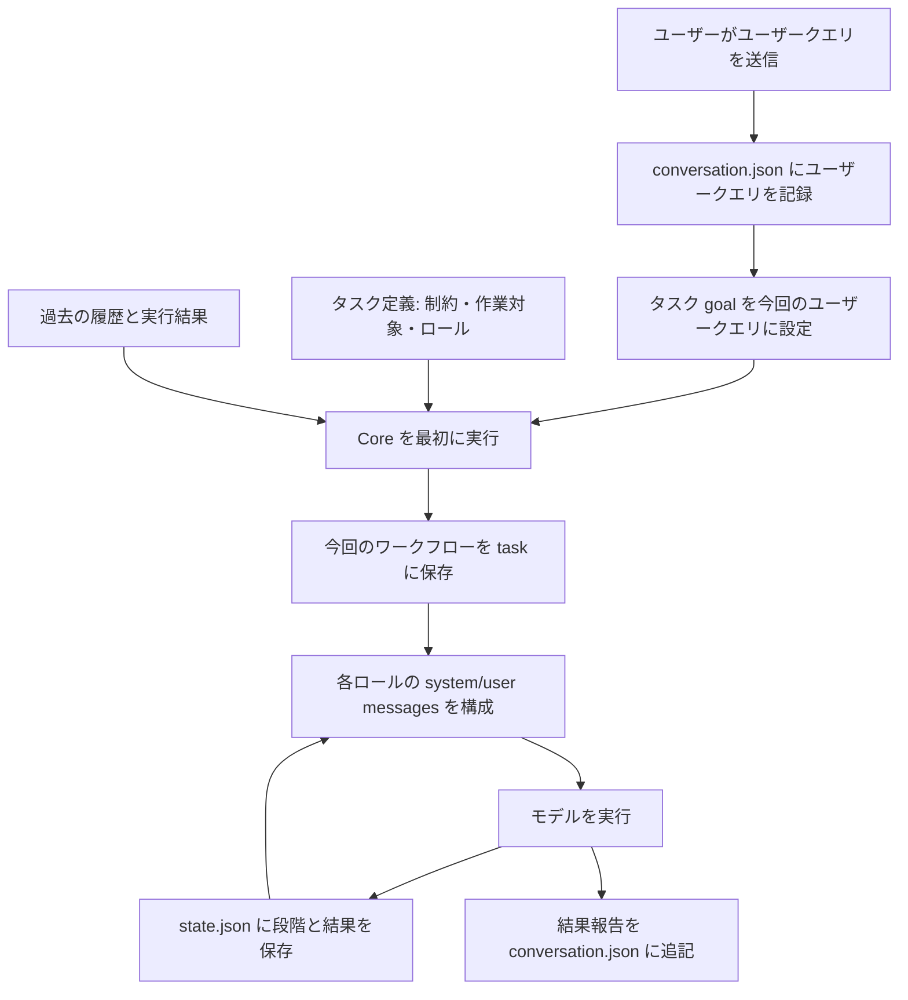

# Ataraxia 技術仕様書

## 目的

Ataraxia は、ユーザーが定義した作業をローカルで実行する AI エージェントである。**設計は特定のドメインに限定しない。** 調査、執筆、分析、ソフトウェア変更など、分野ごとの処理はタスクの構造化データで定義し、共通の実行基盤で扱う。分野固有の動作は、タスクの目標、制約、ロール、スキーマ、ワークフローに記述する。

エージェントは設定可能な PDCA サイクルを実行する。計画、作業、検証、改善を行い、次に実行する段階を選ぶ。タスク単位でロールやワークフロー段階を追加、変更、削除でき、共通の実行スクリプトを変更する必要はない。

## 用語定義

本文では次の用語を標準表記として使う。同じ概念に別の日本語名を重ねて使わず、コード、設定、保存ファイルを示す場合は対応する識別子を併記する。

| 用語 | 定義 | 対応する識別子・保存先 | 表記規則 |
| --- | --- | --- | --- |
| プロジェクト | タスクとセッションをまとめるデータの単位。 | `projects/<project_name>/`、`project_name` | データの所属先を指す場合は「プロジェクト」とする。 |
| 実行設定 | 起動時に共有設定と選択中のプロジェクトを指定する設定ファイル。 | `configs/config.json` | この設定ファイルを指す場合は「実行設定」とする。 |
| タスク | セッション内でユーザークエリを実行するための構造化された定義。現在のユーザークエリ、制約、作業対象、利用可能ロールと、Core が決めたワークフローを保持する。タスクはユーザークエリそのものや会話履歴ではない。 | `*.task.json`、`goal`、`constraints`、`working_directory`、`roles`、`workflow` | 実行定義を「タスク」、ユーザー入力を「ユーザークエリ」と呼び分ける。 |
| セッション | プロジェクト内で、ひとつのタスク定義、複数のユーザークエリと結果報告からなる会話履歴、ワークフロー実行状態、作業対象をまとめて保持する単位。 | `sessions/<session_id>/`、`session.json`、`conversation.json`、`state.json` | 一連のユーザークエリと実行履歴を束ねる単位を「セッション」とする。 |
| ユーザークエリ | ユーザーが一回の送信でエージェントに実行させる内容。送信ごとに新しいユーザークエリとして会話履歴へ追加し、タスクの `goal` に現在の内容を設定する。直前のユーザークエリを編集して再送した場合は新規追加せず、直前のユーザークエリ以降の履歴を分岐として置き換える。 | `conversation.json` の `user_query`、タスクの `goal` | ユーザー入力は「ユーザークエリ」と呼ぶ。「依頼」「指示」「プロンプト」はユーザー入力の名称に使わない。 |
| プロンプト | 特定のロールを一度実行するためにモデルへ送る入力。システムプロンプト、ロール用に選択・整形した JSON 入力、必要なメディアを Chat API の `messages` として構成する。ユーザークエリはプロンプトを構成する情報の一部であり、両者を同一視しない。 | Chat API `messages[]`、`role`、`content` | モデルに送る入力全体を「プロンプト」、ユーザーの一回の送信を「ユーザークエリ」と呼ぶ。 |
| システムプロンプト | ロールの動作、制約、出力形式をモデルに指示する固定文。プロンプトを構成する一要素。 | `data/default-user/sysprompt/*.json`、`system_prompt` | 固定指示文は「システムプロンプト」とする。 |
| ロール | 入力スキーマに従って情報を受け取り、出力スキーマに従って結果を返す担当機能。 | `roles[]`、`role_id` | 担当機能は「ロール」とする。「役割」と混在させない。 |
| 入出力スキーマ | ロールへ渡す JSON 項目と、ロールが返す JSON 項目の名前・型・制約を定める定義。 | `input_schema`、`output_schema`、`configs/role-contracts.json` | ロールの入力・出力形式は「入出力スキーマ」とする。 |
| ワークフロー | タスクを完了するためのロール実行順序と遷移条件。 | `workflow`、`workflow.stages` | 全体の処理手順を指す場合は「ワークフロー」とする。 |
| ワークフロー段階 | ワークフロー内でロールを実行し、結果を記録して次の遷移を決める単位。 | `workflow.stages[].id`、`phase` | 個々の処理単位は「段階」とする。「ステージ」「フェーズ」は使わない。ただしコード識別子は原表記を保つ。 |
| 作業対象 | エージェントが読み書きする、タスクで指定されたディレクトリとその配下のファイル。 | `working_directory`、`workspace_files` | ディレクトリとファイル群は「作業対象」とする。「ワークスペース」と混在させない。 |
| 文脈 | ユーザークエリを処理するためにロールへ渡すタスク情報と、これまでに蓄積した結果。 | `context`、`results`、`context_summary` | ロールが参照する蓄積情報は「文脈」とする。 |
| 実行状態 | ワークフローの現在位置と、これまでのロール結果・結果報告を保存したデータ。 | `state.json`、`state.history` | 保存された進行情報は「実行状態」とする。「状態ファイル」と書く場合も対象は `state.json` とする。 |
| 差分 | 作業対象の変更前後を表す、適用・検証可能な変更操作。 | `file_changes[]`、`retain`、`delete`、`insert` | ファイル変更の単位は「差分」とする。 |
| 結果報告 | ロールの実行結果をユーザーに伝える見出しと本文。 | `report.heading`、`report.body` | ユーザー向けの見出しと本文は「結果報告」とする。 |
| 表示言語 | ユーザーが画面や結果報告で認識する言語。 | `user_output_language`、`interface_language` | ユーザー向け言語は「表示言語」とする。 |
| 内部言語 | ロール間で内部情報を扱う際の言語。 | `internal_language` | 内部処理に使う言語は「内部言語」とする。 |

## 起動方法とプロジェクトデータ

| 構成要素 | 役割 |
| --- | --- |
| `Ataraxia.exe` | Windows GUI 用の薄い起動ラッパー。PowerShell を検出して引数を `scripts/Start-AtaraxiaGui.ps1` に渡す。PowerShell やランタイムは同梱しない。 |
| `launcher/AtaraxiaLauncher.cs` | 起動ラッパーのソースコード。Windows 標準の .NET Framework のみを使う。 |
| `tools/Build-Ataraxia.ps1` | Windows 標準の .NET Framework C# コンパイラーで、複数サイズのアイコンを埋め込んだ `Ataraxia.exe` を再生成する。 |
| `scripts/Invoke-Agent.ps1` | タスクの作成、実行、再開 |
| `scripts/AgentCore.ps1` | ワークフローの解釈、ロール入力の作成、スキーマ検証、文脈圧縮、状態遷移 |
| `scripts/AgentHarness.ps1` | 指定された作業対象の読み込み、差分の検証、許可リストにあるコマンドの実行 |
| `scripts/WorkspaceDiff.ps1` | 行単位の構造化差分とハッシュの作成・検証 |
| `scripts/Start-AtaraxiaGui.ps1` | タスク作成、ワークフロー実行、結果報告の確認、直前のユーザークエリの編集を行う Windows GUI |
| `scripts/KoboldCppApi.ps1` | ローカルの KoboldCpp API によるトークン数の計測 |
| `scripts/KoboldCppSettings.ps1` | KoboldCpp 共通設定の読み込みと起動引数の作成 |
| `scripts/Initialize-KoboldCpp.ps1` | 任意の KoboldCpp 取得・初期化処理 |

共通スクリプトは `scripts/`、共有設定は `configs/`、表示言語の定義は `locales/` に置く。既定のプロジェクトデータは `projects/Ataraxia/` に保存し、`configs/config.json` の `project_name` で対象名を選択する。

`Ataraxia.exe` は配置場所を基準に GUI スクリプトを呼び出す。PowerShell 7 を優先し、見つからない場合は PATH または Windows 標準位置から Windows PowerShell を使う。Windows PowerShell 5.1 でも日本語を正しく解釈できるよう、実行される PowerShell スクリプトは UTF-8 BOM 付きで保存する。起動時のスプラッシュには `assets/splash/ataraxia-project-cover.png` を中央に表示し、最低 1.1 秒でメイン画面へ切り替える。`-NoSplash` を指定すると省略する。起動引数は GUI スクリプトへそのまま転送するため、`-ConfigPath` も指定できる。異常終了時は選択した PowerShell のパスとエラー出力をダイアログに表示する。ラッパーは GUI スクリプトや PowerShell ランタイムを埋め込まず、追加のライブラリ依存を導入しない。ブランド画像と実行ファイル用アイコンは `assets/branding/`、ロールアイコンは `assets/role-icons/` に置く。実行ファイルのアイコンは `assets/branding/ataraxia-app-icon.png` を元に作成し、ロゴと同じ古典的なセリフ体の大文字 A を使う。ソース変更後は `tools/Build-Ataraxia.ps1` で ICO と実行ファイルを再生成する。

各プロジェクトは `projects/<project_name>/sessions/<session_id>/` に独立したセッションを保存する。セッションには `session.json`、タスク定義、`state.json`、`conversation.json`、専用の作業対象 `workspace/` が含まれる。セッションを切り替えると、そのセッション固有のタスク定義、ユーザークエリ履歴、実行状態を読み戻す。プロジェクトデータはユーザーデータとして扱い、ソース管理から除外する。

左側のプロジェクトドロワーでは、有効なプロジェクトフォルダーの切り替え、新規作成、名前変更を行える。新規作成したプロジェクトは直ちに選択される。切り替えは、選択中の実行設定にある `project_name` だけを更新する。名前変更ではフォルダーを移動し、移動先が使用済みなら拒否する。名前変更したプロジェクトが選択中なら実行設定と読み込み済みタスクのパスも更新する。ワークフロー実行中はプロジェクト操作を無効にする。

## 分野に依存しないワークフロー

`Invoke-Agent.ps1 -New <name>` は、プロジェクトフォルダーに構造化されたタスクひな形を作成する。`-Run <task-path>` はタスクに定義されたワークフローを実行する。`-Step 1` は段階をひとつ実行し、`-Step -1` は終端状態まで続ける。`-Resume` は既存タスクの状態から再開する。

タスクは `goal`、`context`、`constraints`、`working_directory`、`roles`、`workflow` を定義する。新しいユーザークエリの実行では、`core` ロールを必ず最初に呼び出し、そのユーザークエリ、制約、作業対象、過去の結果、利用可能なロールを基に段階と遷移候補を再設計する。段階実行の継続では同じユーザークエリの設計を維持する。Ataraxia は定義済みロールだけが選ばれていること、段階IDと結果キーの一意性、遷移先、初期段階からの到達可能性、完了状態への経路を検証してからタスクへ保存する。実行時のルーターは各段階が宣言した候補から次の段階を選ぶ。ロールは目的、システムプロンプト、入力スキーマ、出力スキーマを持つ。新しいタスクひな形のロール定義は `configs/role-contracts.json` から作成する。旧形式のタスクも初回実行時に Core と Router を補い、次のユーザークエリから Core がワークフローを設計する。以前の状態と結果は保持する。

### タスク・ユーザークエリ・プロンプトのライフサイクル

タスクはセッション内に一つ保存し、ユーザークエリを実行するたびにその `goal` を今回のユーザークエリ本文へ更新する。ユーザークエリ本文そのものと時系列は `conversation.json` に蓄積し、各ロールの結果報告も同じ履歴に記録する。`state.json` は現在のユーザークエリに対する Core の設計、段階位置、結果を保持する。したがって、タスクは実行定義、ユーザークエリはユーザーが送信した内容、プロンプトは各ロールの実行時に構成されるモデル入力であり、保存単位も役割も異なる。

実行中に判断材料やユーザー提供情報が不足した場合、ルーターは通常の次段階や完了に加えて `AwaitUser` を選べる。これはワークフローの終端状態ではなく、実行を中断してユーザークエリを待つ状態である。ここへ遷移する前のロール結果、報告、適用済み差分は保存される。GUI は待機状態を表示し、ユーザーが追加のユーザークエリを送信すると、同じセッションのタスク `goal` を更新して Core から新しいワークフローを設計する。過去の状態と結果を次の Core に渡し、既存の作業対象変更は保持する。単に実行を止める操作は従来どおり差分を復元し、ユーザー判断を待つ中断とは区別する。

現行ワークフローでは進められないものの、追加情報があれば自律的に解決できる場合は、ルーターが `ReplanCore` を選択できる。実行基盤は同じユーザークエリと蓄積済みの結果を保持して Core に戻り、Core は別の段階構成を設計して実行を続ける。ユーザーにしか答えられない判断や不足情報がある場合に限り `AwaitUser` を選ぶ。自律再計画はユーザークエリごとに最大 2 回とし、タスクの `workflow.max_core_replans_per_query` で変更できる。上限後はルーターに再計画を提示せず、利用可能な通常段階またはユーザー待ちを選ばせる。

段階実行の継続（`-Resume` など）は同じユーザークエリの続きとして扱い、Core による再設計を挟まない。ワークフロー完了後または `AwaitUser` 待機中に `-Run` を実行した場合は、新しいユーザークエリ本文が前回と同じでも新しいユーザークエリとして扱い、Core から始める。GUI で直前のユーザークエリを編集して再送した場合は会話履歴の分岐を作り、対応する実行状態も分岐前へ戻して新しいユーザークエリとして Core に渡す。

各ロールには専用の入力スキーマを定義し、担当作業に必要な項目だけを渡す。次の表に、標準ロールの識別子、既定の実行条件、機能、必須入力、必須出力、システムプロンプトを示す。タスク作成者はタスクデータで実行段階を変更できる。実行条件の列は既定ワークフローの内容である。

`core` と `planner` は異なる階層を担当する。Core はワークフロー設計者として、必要なロールとその実行順序・遷移を決める。Planner は計画作成者として、選ばれた場合に実行可能な行動の順序、前提条件、完了基準を作る。Core はタスクの行動計画を作らず、Planner はロール構成やワークフロー遷移を決めない。単純な作業では Core は Planner を省略できる。複数の依存する行動、不確実性、または明示的な計画要求がある場合に Planner を含める。Plan は Planner が実行されるワークフロー段階の識別子の例であり、Planner ロールそのものとは区別する。

| アイコン | ロール名・識別子 | 既定の実行条件 | 機能 | 必須入力項目 | 必須出力項目 | スキーマ・システムプロンプト |
| --- | --- | --- | --- | --- | --- | --- |
|  | ワークフロー設計 / `core` | 新しいユーザークエリの実行時に必ず最初 | 必要なロールと実行順序・遷移を選び、ワークフローを設計する。行動レベルの計画や完了基準は作らない。出力後、許可されたロール、遷移先、到達可能性をコードで検証する。 | `goal`, `context`, `constraints`, `workspace_files`, `workspace_media`, `available_roles`, `user_output_language`, `internal_language` | `workflow`（`initial_stage`, `stages[]`） | 入力 `agent_core_input` → 出力 `agent_core_output`。プロンプト `agent_core.json` |
|  | 計画作成 / `planner` | 複数の依存する行動、不確実性、明示的な計画要求がある場合に Core が選択 | 実行可能な行動を順序化し、前提条件と測定可能な完了基準を作る。ワークフロー段階や担当ロールは決めない。 | `goal`, `context`, `constraints`, `cycle`, `latest_stage`, `results`, `workspace_files`, `context_summary`, `user_output_language`, `internal_language` | `plan`, `actions`, `success_criteria` | 入力 `agent_planner_input` → 出力 `agent_planner_output`。プロンプト `agent_planner.json` |
|  | 調査 / `researcher` | ルーターが選んだ `Research` 段階 | 作業対象のファイルやメディアを調べ、目標に関係する根拠を集める。 | `goal`, `context`, `constraints`, `cycle`, `latest_stage`, `results`, `workspace_root`, `workspace_files`, `workspace_media`, `context_summary`, `user_output_language`, `internal_language` | `findings`, `workspace_sources`, `open_questions` | 入力 `agent_researcher_input` → 出力 `agent_researcher_output`。プロンプト `agent_researcher.json` |
|  | 作業 / `executor` | ルーターが選んだ `Do` 段階 | 検証可能なファイル差分と、許可リストにあるコマンドを提案する。 | `goal`, `context`, `constraints`, `cycle`, `phase`, `phase_data`, `latest_stage`, `results`, `workspace_root`, `workspace_files`, `workspace_media`, `allowed_commands`, `context_summary`, `user_output_language`, `internal_language` | `result`, `file_changes`, `commands`, `status` | 入力 `agent_executor_input` → 出力 `agent_executor_output`。プロンプト `agent_executor.json` |
|  | レビュー / `reviewer` | `Check` 段階 | 適用された変更とコマンドの根拠を目標・完了条件と照合する。 | `goal`, `context`, `constraints`, `cycle`, `phase`, `phase_data`, `latest_stage`, `results`, `workspace_root`, `workspace_files`, `workspace_media`, `context_summary`, `user_output_language`, `internal_language` | `approved`, `findings`, `next_actions` | 入力 `agent_reviewer_input` → 出力 `agent_reviewer_output`。プロンプト `agent_reviewer.json` |
|  | 改善 / `improver` | レビュー後の `Act` 段階 | レビュー指摘を修正内容と次の計画にまとめる。 | `goal`, `context`, `constraints`, `cycle`, `phase`, `phase_data`, `latest_stage`, `results`, `workspace_files`, `context_summary`, `user_output_language`, `internal_language` | `changes`, `next_plan` | 入力 `agent_improver_input` → 出力 `agent_improver_output`。プロンプト `agent_improver.json` |
|  | 次段階の選択 / `router` | ワークフロー段階間の `Route` 段階 | 記録済みの根拠を基に、許可された次段階または終端状態を選ぶ。 | `goal`, `context`, `constraints`, `cycle`, `phase`, `phase_data`, `latest_stage`, `results`, `available_next_stages`, `context_summary`, `user_output_language`, `internal_language` | `next_stage`, `rationale` | 入力 `agent_router_input` → 出力 `agent_router_output`。プロンプト `agent_router.json` |
|  | 検証 / `verifier` | ルーターが選んだ `Verify` 段階 | 各完了条件が作業対象とコマンドの根拠によって満たされたか確認する。 | `goal`, `context`, `constraints`, `cycle`, `phase`, `phase_data`, `latest_stage`, `results`, `workspace_root`, `workspace_files`, `workspace_media`, `context_summary`, `user_output_language`, `internal_language` | `verified`, `findings`, `evidence` | 入力 `agent_verifier_input` → 出力 `agent_verifier_output`。プロンプト `agent_verifier.json` |
|  | セキュリティ確認 / `security_reviewer` | ルーターが選んだ `Audit` 段階 | 提案または適用された変更から具体的なリスクを特定し、対策を示す。 | `goal`, `context`, `constraints`, `cycle`, `phase`, `phase_data`, `latest_stage`, `results`, `workspace_root`, `workspace_files`, `workspace_media`, `context_summary`, `user_output_language`, `internal_language` | `risk_level`, `findings`, `required_actions` | 入力 `agent_security_reviewer_input` → 出力 `agent_security_reviewer_output`。プロンプト `agent_security_reviewer.json` |
|  | 影響評価 / `impact_reviewer` | 計画後、ルーターが必要と判断した場合の `Impact` 段階 | 実装前に互換性、既存データ、依存関係、利用者への影響、可逆性を確認し、対策を提案する。セキュリティ監査とは分け、機能的・運用的な影響を扱う。 | `goal`, `context`, `constraints`, `cycle`, `phase`, `phase_data`, `latest_stage`, `results`, `workspace_root`, `workspace_files`, `context_summary`, `user_output_language`, `internal_language` | `impact_level`, `affected_areas`, `findings`, `mitigations`, `reversible` | 入力 `agent_impact_reviewer_input` → 出力 `agent_impact_reviewer_output`。プロンプト `agent_impact_reviewer.json` |
|  | 文脈圧縮 / `context_compressor` | 計測した入力が設定済みのしきい値またはコンテキスト上限を超えた場合 | 判断、要件、根拠、未解決項目を保って文脈を短縮する。 | `goal`, `context`, `constraints`, `latest_stage`, `results`, `target_tokens`, `user_output_language`, `internal_language` | `compressed_context`, `retained_facts`, `open_items` | 入力 `agent_compressor_input` → 出力 `agent_compressor_output`。プロンプト `context_compressor.json` |
|  | 結果報告 / `reporter` | 結果報告ロール自身を除く各ワークフローロールの完了後 | ロールの結果を、見出しと読みやすい本文にまとめる。 | `goal`, `phase`, `latest_stage`, `results`, `user_output_language`, `internal_language` | `heading`, `body` | 入力 `agent_reporter_input` → 出力 `agent_reporter_output`。プロンプト `reporter.json` |
|  | セッション命名 / `session_namer` | 新しいセッションで最初のユーザークエリを受けた後、ワークフロー開始前に一度 | 設定された表示言語で短いセッション名を作る。ユーザーが変更した名前は自動で上書きしない。 | `first_prompt`, `user_output_language`, `internal_language` | `title` | 入力 `session_namer_input` → 出力 `session_namer_output`。プロンプト `session_namer.json` |

スキーマ名は `configs/role-contracts.json` 内の定義を参照し、システムプロンプトは `data/default-user/sysprompt/` に置く。実行時に共通のワークフローデータから各ロールの入力項目を選び、送信前に検証する。受信した JSON も各ロールの出力スキーマで検証し、未定義の出力項目を拒否する。

標準ロールは分野に依存しない再利用可能な例である。タスクデータでは分野固有のロールも定義できる。新しいセッションの最初のユーザークエリを受けると、セッション命名ロールが設定された表示言語で簡潔な名前を作り、セッション情報に保存する。ユーザーが名前を変更した場合、自動命名では上書きしない。

## 作業対象の変更とコマンド

作業ロールは相対パス、操作、変更前の SHA-256 ハッシュ、`retain` / `delete` / `insert` 操作からなる `file_changes[]` を返す。Ataraxia は適用前に各差分を対象ファイルとハッシュに照らして検証する。タスクの `working_directory` の外に出るパス、再解析ポイントを経由するパス、重複したパス、不一致のハッシュ、削除対象行が一致しない差分は拒否する。絶対パス、上位・カレントディレクトリ参照、制御文字、Windows の予約名や不正なパス要素も拒否し、1段階あたりの変更ファイル数と各差分の操作数に上限を設ける。適用するテキストは UTF-8 として検証し、NUL や許可されない制御文字、過大な内容を拒否する。

コマンドは `configs/agent-harness.json` の許可設定に、実行ファイルと引数が一致した場合だけ実行する。タスク内のユーザークエリやモデル出力から許可項目を追加することはできない。引数は文字列配列とし、個数・長さ・改行を検証する。標準出力・標準エラーは ANSI 制御列と危険な制御文字を除き、長さを制限してからタスク状態へ記録する。HTTP 通信先は絶対 HTTP(S) URI、エンドポイントは許可文字とパス要素を検証する。

設定、タスク、セッション情報、会話履歴などの JSON ファイルは UTF-8 として読み込み、既定で 4 MiB を上限とする。状態ファイルは 2 MiB、差分ジャーナルは 8 MiB を上限とする。LLM 応答 JSON は 1 MiB を上限とし、JSON 本体だけを受け付ける（単独の JSON コードフェンスは許可）。JSON Schema の型、必須項目、追加項目、長さ、配列数、数値範囲、正規表現をローカルで検証し、テキストの Unicode と制御文字も確認する。プロンプトの適合判定に文字数上限を使わない。ユーザークエリ、タスク文脈、ロール指示、プロジェクト・セッション共通プロンプトを含む実際の system/user メッセージ全体を KoboldCpp のトークン計数 API で計測し、応答予約分を加えたコンテキスト上限と比較する。超過時の分割位置もトークン計数を使って決め、文脈圧縮ロールで再試行する。ファイル読込のバイト上限はプロンプト長制限とは別の破損・過大入力保護である。差分は1段階あたり100ファイル、各ファイル5,000操作、変更対象ファイル1 MiBを上限とし、差分ジャーナル全体にも上限を適用する。コマンドは1段階64件、引数は64個・各4,096文字まで、出力は標準出力・標準エラーごとに20,000文字まで記録する。これらの検証は入力・LLM 応答・ファイル差分・コマンド出力の各境界で行う。

## コンテキストとローカル実行の想定

基準とする KoboldCpp のコンテキストサイズは 8,192 トークンである。ローカルの低リソース環境では、Q4_K_M または Q5_K_M 量子化の 7B～9B GGUF モデル、生成用 4,096 トークン、要約後 512 トークンを想定する。これらは計画上の目安であり、モデルごとの保証値ではない。利用環境に合わせ、モデルの要件と共有設定を確認する。

トークン数は KoboldCpp の `POST /api/extra/tokencount` で計測する。role固有system prompt、ペルソナ、共通プロンプト、ユーザークエリ、ロール入力を結合した実際の Chat API メッセージと最大応答トークン数を計算に含める。入力が設定上限を超えた場合、文脈圧縮ロールが内容を要約し、対象ロールを再試行する。再計測後も上限内に収まらない場合はエラーで停止し、文字数による推定には切り替えない。分割圧縮では KoboldCpp のトークン計数に基づき分割点を決める。

## 報告と GUI の動作

結果報告ロールは、設定された表示言語で `heading` と `body` を返す。各タスク段階の結果と報告は `state.json` に保存する。結果報告ロール自身や内部の文脈圧縮処理は、ユーザー向け報告の対象にしない。

GUI はユーザークエリとロール報告を会話順のチャット形式で表示する。ユーザークエリは右寄せ、ロール報告は左寄せの吹き出しとし、テーマの無彩色配色に沿って視覚的に区別する。プロジェクト、セッション、ファイル参照、実行操作のボタンは意味に沿ったアイコンを使い、アイコン色はテーマブラシから取得する。文字ラベルはツールチップに置き、実行中は送信アイコンを停止アイコンへ切り替える。ユーザークエリ入力欄では Enter で送信し、Shift+Enter で改行する。会話欄がスクロール可能で、表示位置が末尾から離れている場合は入力欄の上中央に末尾へ移動する下向きアイコンを表示する。ユーザークエリ・見出し・報告本文のテキストは部分選択できる。ドロワーには各プロジェクト行の右端に新規セッション開始アイコンを表示する。この操作はそのプロジェクトを選択した新規セッション画面を開く。新規セッションは最初のユーザークエリが送信されるまで ID を割り当てず、セッションフォルダー、タスク、メタデータなどのファイルを作成しない。ユーザークエリ欄が空の場合も作成しない。ドロワーにはプロジェクト一覧の下に折りたたみ可能な「最近のセッション」を表示する。最後にユーザークエリを送信した日時が新しい順に、ユーザークエリ履歴のあるセッションを `gui.recent_sessions_max` 件まで表示し、選択すると該当プロジェクトへ切り替えてそのセッションを開く。上限の既定値は 5 件。標準ロールの見出しには `assets/role-icons/` の SVG アイコンを添える。WPF は追加の GUI ライブラリなしで、対応するベクター形状を描画する。報告の見出しを選ぶと本文を展開または折りたたむ。プロジェクト画面の右上にはセッション選択、名前変更、新規セッション開始のアイコンボタンを置く。新規セッションボタンは文書に追加記号を重ねたアイコンとし、言語別ツールチップを表示する。直前のユーザークエリを編集すると、そのユーザークエリ以降の会話項目を現在の分岐から除く。再実行前に以前の状態を分岐ファイルとして保存する。適用済みの作業対象変更はそのまま残り、新しい実行からも参照できる。

GUI とコマンドラインは `Invoke-Agent.ps1` を共用する。GUI は Windows 標準の WPF を使い、追加モジュールのインストールやローカル Web サーバーの起動を必要としない。GUI には KoboldCpp の取得・起動・停止・再起動機能を設ける。起動時に共有設定で指定された実行ファイルが見つからない場合に限り、取得専用の `Initialize-KoboldCpp.ps1` をバックグラウンド実行して公式リリースを取得・検証する。取得中もGUIを操作可能にし、状態を表示する。取得後もモデルの取得およびKoboldCppサーバーの自動起動は行わない。再起動は GUI が起動して管理中のプロセスに限り、表示中の生成パラメータを保存してから停止し、API ポートが解放されたことを確認して起動する。外部プロセスが接続先を使い続ける場合は再起動を中止する。起動したプロセスは GUI が管理し、GUI 終了時に停止する。設定された API ポートへの TCP 接続を定期確認し、接続中を緑、起動中を橙、未接続を赤で表示する。既に別プロセスが接続先を使用している場合は起動せず接続中として扱う。

GUI の既定 Windows コントロール外観は使用せず、ボタン、入力欄、選択欄、展開欄、スライダー、スクロールバー、進捗表示、コンテキストメニューを独自のベクターテンプレートで描画する。文字入力や選択などの操作性・キーボード操作を保つため、操作部品自体は WPF 標準コントロールを使う。操作アイコンは `assets/ui-icons/`、ロールアイコンは `assets/role-icons/` の SVG を読み込み、WPF のベクター形状に変換してテーマ色で描く。SVG 表示用の外部ライブラリは導入しない。GUI のテーマは `gui_theme` でライト、ダーク、システム設定準拠から選ぶ。システム設定は起動時に一度だけ読み取り、実行中に定期確認しない。テーマは無彩色を使い、文字と背景の輝度差を十分に確保する。アイコン色は画面内のテーマアイコン色と共有する。

ダイアログも既定のOSウィンドウ枠、標準メッセージボックス、標準ファイル・フォルダー選択画面を使わず、アプリ内のSVGアイコンとテーマ色で描画する。ダイアログの種類、入力、結果は `configs/gui-dialog-contracts.json` に定義するプラットフォーム非依存の契約を介して扱い、`scripts/GuiDialogs.ps1` は現在のWPF描画アダプターとする。契約と表示処理を分離し、将来GUI基盤を変更するときもダイアログの意味や呼び出し側を維持できるようにする。ダイアログ用SVGは `assets/ui-icons/dialog-*.svg` に置く。

プロジェクトは `projects/<project>/project.json` の `common_prompt`、セッションは `projects/<project>/sessions/<session-id>/session.json` の `common_prompt` に共通プロンプトを保持する。両方が設定されている場合はプロジェクト、セッションの順で結合し、各ロールの system message に追加する。ユーザークエリやロール固有の入力データも従来どおり user message に含め、共通プロンプトと合わせてモデルへ渡す。

GUI 起動時にモデル配置先とその配下から GGUF ファイルを再帰検索してモデル選択欄へ表示する。選択値を `koboldcpp-settings.json` の `paths.model_file` に保存でき、一覧は手動更新もできる。モデルを切り替えて KoboldCpp を起動する場合は、既存プロセスを停止してから GUI の起動ボタンを使う。モデル別 JSON 上書きが存在する場合、そのモデルを選択した状態で生成パラメータ欄に有効値を表示する。数値パラメータは有効範囲を制限したスライダーと数値入力を同期し、範囲外・刻み幅外の値は保存しない。文字列および停止文字列はテキスト入力で編集する。設定値は参照中の `koboldcpp-settings.json` に保存し、リクエストへ反映する。

## LLM の構造化データと言語

LLM との入出力は JSON オブジェクトで統一する。`json_pretty` と `json_indent` は、JSON を可読形式で整形するか、および字下げ幅を設定する。ロールの出力は JSON Schema で形式を制約し、受信後にもローカルで検証する。ユーザーが認識する言語は `user_output_language` で選択する。内部ロール ID、ワークフロー ID、状態キー、制御値は英語とする。コンソール表示は構造化ログを言語別の表示層で変換する。

## 設定と依存関係

`configs/config.json` は `koboldcpp-settings.json`、`role-contracts.json`、`agent-harness.json` を参照する。モデルの選択と配置はユーザーが行う。任意の初期化スクリプトは KoboldCpp を別途取得し、公開されている場合は SHA-256 ダイジェストを検証する。Ataraxia はモデルの重みを同梱またはダウンロードしない。

### KoboldCpp の取得と起動手順

`scripts/Initialize-KoboldCpp.ps1` は取得・初期化専用である。GUI は起動時に設定された KoboldCpp 実行ファイルがない場合だけ、このスクリプトをバックグラウンド実行する。CLIやエージェント実行からは自動起動しない。処理順は次のとおり。

1. `configs/config.json` から `koboldcpp_settings_path` を解決して `configs/koboldcpp-settings.json` を読み、インストール先、モデル配置先、モデル名、サーバーポート、起動引数を取得する。
2. `runtime/koboldcpp/` と `models/`（設定で変更可能）を用意する。
3. `-Build` の既定値 `auto` では、Windows の `Win32_VideoController` 情報に NVIDIA／GeForce／Quadro／Tesla の名称がある場合に `cuda`、それ以外または情報取得失敗時に `nocuda` を選ぶ。旧世代GPUのCUDA互換性は名称から確定できないため、必要なら `-Build oldpc` を明示する。`cuda` は `koboldcpp.exe`、`nocuda` は `koboldcpp-nocuda.exe`、`oldpc` は `koboldcpp-oldpc.exe` を選ぶ。`-Build cuda|nocuda|oldpc` による自動判定の上書きを許可する。ダウンロード後、リリースの SHA-256 ダイジェストと照合してから `koboldcpp.exe` として保存し、共有設定へリリースタグとハッシュを記録する。
4. モデルは自動取得しない。ユーザーが GGUF をモデル配置先へ置き、`koboldcpp-settings.json` の `paths.model_file` にファイル名を指定する。
5. `-Launch` を指定した場合、モデルファイルの存在を確認する。同じモデル名の `.json` サイドカーがあれば `startup_parameters` と `request_parameters` を共通設定に上書きして有効設定を作る。
6. 有効設定から `--model`、`--port`、`--contextsize` と追加の起動パラメータを組み立て、`runtime/koboldcpp/koboldcpp.exe` をバックグラウンド起動する。既定のポートは `5001`、既定のコンテキストサイズは `8192`。
7. 指定ポートへの TCP 接続を最大60秒待ち、起動成功またはプロセス終了・タイムアウトを報告する。

実行例は `pwsh -File .\\scripts\\Initialize-KoboldCpp.ps1 -Launch`。`-Build` を省略すると `auto` を使う。`-Launch` を省略すると実行ファイルの取得・設定保存までを行い、KoboldCpp は起動しない。初期化スクリプトを実行するには GitHub へのネットワーク接続が必要である。GUI から起動しない場合、GUI とエージェントは `configs/koboldcpp-settings.json` のホスト・ポートにある既存 API を利用する。現行スクリプトは初期化を実行するたびに最新リリース情報を照会し、選択ビルドを取得する。

Ataraxia のソースコードは MIT ライセンスである。任意の外部実行ファイルである KoboldCpp は別の AGPL-3.0 ライセンスで提供され、同梱される各部品のライセンス表示も適用される。モデルとユーザー提供ファイルには、それぞれ固有の利用条件が適用される。コピーレフト対象のコードを Ataraxia に複製またはリンクしない。プロセスを分けることだけでは法的判断は確定しないため、連携方法と配布状況を記録し、ライセンスを個別に確認する。

## 開発要件

- テスト駆動開発を行う。実装前に失敗するテストを追加または変更し、その後、テスト一式を実行する。
- 共通動作は共通基盤に置き、分野固有の動作はタスクデータに定義する。
- 中間データは構造化する。画面表示用の翻訳文は言語定義ファイルに置き、ユーザーデータは `projects/` 配下に置く。
- 旧スクリプト名や旧状態形式との互換性は、個別に要件として指定されない限り保証しない。
- インターフェース、状態、ワークフロー、依存関係を変更した場合は、この仕様書と README を更新する。

